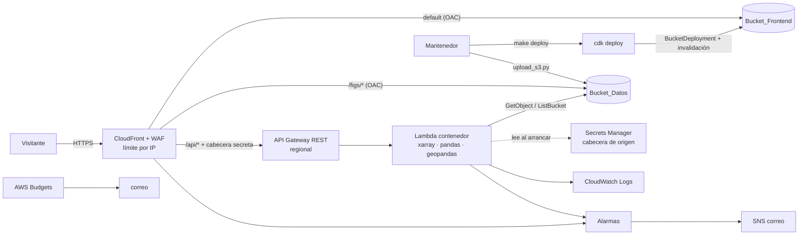
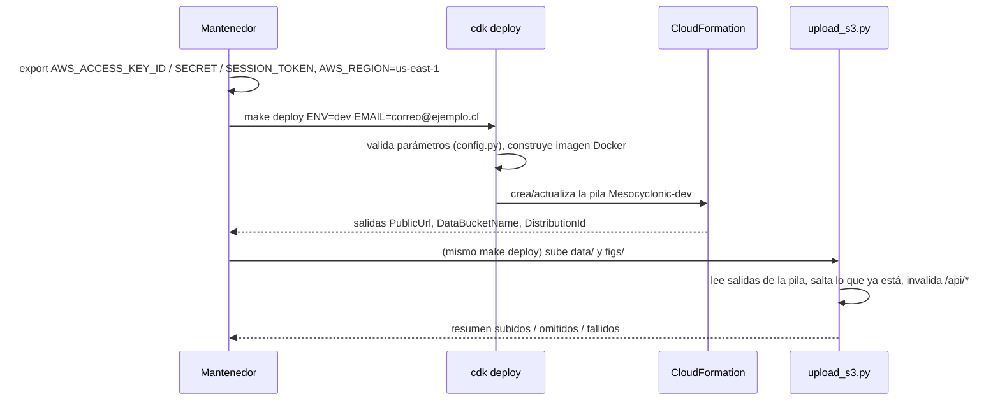

# Documento de diseño: despliegue en AWS (aws-cloud-deployment)

## Overview

Este diseño publica los datos y un visor web del proyecto en AWS con un solo comando, desde la cuenta de AWS de cualquier integrante del equipo, en `us-east-1`.

**Decisión: Opción A (frontend estático + API).** La interfaz pública es un sitio HTML/JS sin paso de compilación, guardado en S3 y servido por CloudFront. CloudFront envía `/api/*` a API Gateway, que invoca una función Lambda que lee el Bucket_Datos. Se eligió porque:

- No queda ningún servidor encendido: el costo con poco tráfico se acerca a cero, salvo el costo fijo del WAF (ver Costos en Testing Strategy).
- CloudFront guarda en caché casi todas las respuestas, porque los datos cambian solo cuando alguien ejecuta el Script_Carga.
- El visor Streamlit sigue sirviendo para trabajar en local (`make viewer`, `docker compose up`).

**Fuera de alcance.** Las partes de la Opción_B no se implementan: el Requisito 7 completo, 9.4, 9.9, 10.4 y las menciones al Servicio_Visor en 1.1, 1.8, 4.4, 4.8, 4.9, 8.1, 8.4, 8.6, 8.8 y 10.1. En esos criterios solo aplica lo que dicen de la API_Datos.

**Qué se toca del repositorio.**

| Ruta | Contenido |
|---|---|
| `infra/` | App_CDK en Python (aws-cdk-lib v2): `app.py`, `config.py`, `stack.py`, `cdk.json` |
| `services/api/` | Código de la Lambda (`handler.py`, `routes.py`, `store.py`, `fields.py`, `serialize.py`) y su `Dockerfile` |
| `frontend/` | Sitio estático: `index.html`, `error.html`, `css/`, `js/`, `vendor/plotly-<versión>.min.js` |
| `scripts/pipeline/upload_s3.py` | Script_Carga (boto3) |
| `scripts/viewer/viewer_app/core.py` | Reglas puras compartidas entre el visor y la API, sin Streamlit (refactor sin cambio de comportamiento) |
| `docs/despliegue_aws.md` | Guía de despliegue en español, enlazada desde `README.md` |
| `tests/` | Pruebas nuevas: `test_infra.py`, `test_api.py`, `test_upload.py`, `test_core.py` |

**Interpretación de claves.** Se usa la regla del Requisito 2.1: la clave S3 es la ruta relativa a la raíz del repositorio (`data/crops/<región>/...`, `figs/<nombre>.png`). Donde los Requisitos 3.1 y 5.1 dicen "relativa a `data/`" o "`crops/<región>/`", se leen como `data/crops/<región>/`.

## Architecture



### Flujo "cómo se despliega"



`make deploy` ejecuta dos comandos seguidos: `cdk deploy` y `upload_s3.py --env $(ENV)`. Para el equipo es un solo comando. La infraestructura y los datos siguen separados.

### Decisiones y su justificación

1. **API Gateway REST (regional) en vez de HTTP API.** HTTP API cuesta menos por solicitud (1 USD/millón contra 3,50 USD), pero con la caché de CloudFront la diferencia es de centavos al mes. REST API ofrece lo que piden los requisitos y HTTP API no:
   - respuestas de gateway personalizables, para mensajes en español en 403 y 429,
   - throttling por etapa que responde 429 (9.8),
   - métodos declarados uno por uno, de modo que POST, PUT, DELETE y PATCH no tienen integración y se rechazan con 403 (4.5).

   Es regional, no edge-optimized, para no poner un CloudFront delante de otro.
2. **Bloqueo del acceso directo a la API (4.8).** API Gateway no puede exigir con una política de recursos que la solicitud venga de una distribución de CloudFront. Por eso la CDN agrega la cabecera `X-Origin-Verify` con un valor aleatorio que genera Secrets Manager. La plantilla solo guarda una referencia dinámica `{{resolve:secretsmanager:...}}`, nunca el valor (8.6). La Lambda lee el secreto al arrancar y responde 403 si la cabecera falta o no calza.
3. **WAF en CloudFront (scope `CLOUDFRONT`).** Una regla basada en tasa, con agregación por IP y ventana de 300 s, responde 429 con un cuerpo en español (8.4, 8.5). El WAF de CloudFront exige que la pila esté en `us-east-1`, así que toda la pila va en esa región y `config.py` rechaza otra región.
4. **Lambda como `DockerImageFunction` (x86_64, 2048 MB, `/tmp` de 2 GB, timeout de 15 s).** xarray, h5netcdf, pandas, openpyxl y geopandas superan el límite de 250 MB de un zip. La imagen, de hasta 10 GB, se construye en `cdk deploy` con el Docker local. Una sola función atiende todas las rutas con un enrutador interno. Así hay una sola reserva de concurrencia y una sola caché en memoria.
5. **Reglas compartidas sin Streamlit.** `viewer_app/data.py`, `products.py` y `layers.py` importan Streamlit. Las funciones puras que necesita la API pasan a un módulo nuevo, `viewer_app/core.py`, que solo importa numpy, pandas y xarray: `coordinate`, `utc_hour`, `kind_of`, la fecha `AAAAMMDD` de un nombre, la imagen más cercana, la receta `AIRMASS`, `HIDDEN`, `DERIVED` y `DIVERGING`. Los módulos del visor las importan desde `core` y las reexportan con el mismo nombre, así que el visor y sus pruebas no cambian. La Lambda copia `viewer_app/__init__.py`, `core.py`, `components.py` (que tampoco importa Streamlit) y `scripts/common.py`. Así la paridad del Catálogo (5.9) se cumple por construcción y una prueba la vigila.
6. **El frontend se publica con `BucketDeployment` y los datos con un script.** `BucketDeployment` sube `frontend/` e invalida `/*` en cada despliegue (6.9). Para los datos no se usa `BucketDeployment`, por cuatro razones:
   - su Lambda necesitaría `s3:PutObject` sobre el Bucket_Datos, lo que choca con 8.2;
   - empaqueta todo `data/` como un zip en cada cambio, con los límites de `/tmp` y de 15 minutos de Lambda;
   - `prune` borraría objetos que no están en el disco local, contra 3.4;
   - mezclaría la publicación de días nuevos con cambios de infraestructura.

   La experiencia de "un comando" la da `make deploy`.
7. **Retención de logs para todas las Lambda.** Las Lambda auxiliares de CDK (`BucketDeployment`, `autoDeleteObjects`) crean grupos de logs con retención indefinida. Un *Aspect* de CDK recorre cada `AWS::Lambda::Function` de la pila y le crea el grupo `/aws/lambda/<función>` con la retención configurada y `RemovalPolicy.DESTROY` (9.2).
8. **Presupuesto a nivel de cuenta.** Filtrar AWS Budgets por etiqueta exige activar etiquetas de asignación de costos, cosa que se hace en la cuenta de administración, tarda hasta 24 h y no tiene recurso de CloudFormation. Por eso el presupuesto cubre toda la cuenta, un superconjunto de los recursos etiquetados (9.1). Con una cuenta de hackathon dedicada es el comportamiento que conviene. Lleva el nombre del entorno para no chocar entre entornos.
9. **Plotly.js copiado al repositorio.** Plotly.js va con versión fija y su licencia MIT en `frontend/vendor/`, en vez de cargarse desde una CDN externa. Así la CSP permite solo `'self'` y no hay terceros en tiempo de ejecución.

## Components and Interfaces

### 1. App_CDK (`infra/`)

- `cdk.json`: `"app": "uv run python app.py"`.
- `config.py`: `load_config(context: Mapping[str, str | None], env: Mapping[str, str]) -> DeployConfig` es una función pura que lanza `ConfigError(param, rango)` con un mensaje en español. Los valores de contexto (`-c clave=valor`) tienen prioridad sobre las variables de entorno.
- `app.py`: llama a `load_config`. Ante un `ConfigError`, imprime el mensaje en `stderr` y termina con `sys.exit(1)` antes de crear la `App`, así que no se generan plantillas (1.9, 8.9, 9.7, 10.6). Luego crea `MesocyclonicStack(app, f"Mesocyclonic-{env_name}", cfg)` y aplica `Tags.of(app).add("project", "aws-mesocyclonic")` y `Tags.of(app).add("environment", env_name)` (1.5).
- `stack.py`: `MesocyclonicStack` define los recursos de la tabla siguiente.

| Recurso | Configuración clave | Requisitos |
|---|---|---|
| `DataBucket` | `BlockPublicAccess.BLOCK_ALL`, `S3_MANAGED` encryption, `enforce_ssl=True`, versionado, regla de ciclo de vida `noncurrent_version_expiration=Duration.days(cfg.noncurrent_days)` y `abort_incomplete_multipart_upload_after=1 día`. Con `production=False`: `RemovalPolicy.DESTROY` y `auto_delete_objects=True` (borra también las versiones). Con `production=True`: `RemovalPolicy.RETAIN` | 1.6, 1.7, 2.2–2.7 |
| `FrontendBucket` | igual en seguridad, sin versionado, siempre `DESTROY` y `auto_delete_objects` | 6.1 |
| `OriginSecret` | `secretsmanager.Secret` con `generate_secret_string` (32 caracteres, sin puntuación) | 4.8, 8.6 |
| `ApiFunction` | `DockerImageFunction`, `DockerImageCode.from_image_asset(directory=<raíz>, file="services/api/Dockerfile", exclude=[data, .venv, .git, cdk.out, figs, frontend])`, `reserved_concurrent_executions=cfg.lambda_concurrency`, variables `DATA_BUCKET` y `ORIGIN_SECRET_ARN` | 5.x, 9.3 |
| Permisos | política IAM propia con `s3:GetObject` sobre `bucket/*` y `s3:ListBucket` sobre el bucket. No se usa `grant_read`, porque agrega `GetObject*` y `List*`. A eso se suma `secret.grant_read(fn)` | 1.8, 8.1 |
| `Api` | `RestApi` regional; recurso `/api/{proxy+}` con `GET` y `HEAD` (proxy Lambda) y `OPTIONS` (mock 204); `deploy_options`: `throttling_burst_limit = cfg.lambda_concurrency`, `throttling_rate_limit = 2 × cfg.lambda_concurrency`, access logs en un `LogGroup` con retención; respuestas de gateway en español para `THROTTLED` (429), `MISSING_AUTHENTICATION_TOKEN` (403, "método o ruta no permitidos"), `DEFAULT_5XX` | 4.4, 4.5, 9.8 |
| `WebAcl` | scope `CLOUDFRONT`, regla `RateBasedStatement(limit=cfg.rate_limit, aggregate_key_type="IP", evaluation_window_sec=300)`, acción `Block` con `CustomResponse(429, cuerpo JSON en español)` | 8.4, 8.5 |
| `Distribution` | detalle en la tabla de comportamientos de la CDN, más abajo | 4.x, 5.12 |
| `FrontendDeployment` | `BucketDeployment(sources=[Source.asset("frontend")], distribution=dist, distribution_paths=["/*"], memory_limit=512)` | 6.9 |
| `LogRetentionAspect` | crea un `LogGroup` con la retención de `cfg.log_retention_days` para cada `AWS::Lambda::Function` | 9.2 |
| `AlertTopic` | `sns.Topic` con `EmailSubscription(cfg.alert_email)` | 10.2–10.6 |
| Alarmas | `Cdn5xx`: `AWS/CloudFront 5xxErrorRate` (dimensiones `DistributionId`, `Region=Global`), promedio en 5 min > 5, 1 de 1 periodo, `treat_missing_data=NOT_BREACHING`. `ApiErrors`: `fn.metric_errors(period=5 min)` ≥ 1, 3 de 3 periodos, nombre con el de la función. Ambas con `alarm_action` y `ok_action` al tópico | 10.2, 10.3, 10.5 |
| `Budget` | `CfnBudget` `COST` mensual en USD por `cfg.budget_usd`, con avisos `ACTUAL` al 80 % y al 100 % al correo | 9.1 |
| Salidas | `PublicUrl` (`https://<dominio>`), `DataBucketName`, `DistributionId` | 1.2, 2.7, 11.2 |

**Comportamientos de la CDN** (`price_class=PRICE_CLASS_ALL`, la única clase que incluye ubicaciones de borde en Sudamérica; se declara de forma explícita, 9.5; `default_root_object="index.html"`; `minimum_protocol_version=TLSv1.2_2021`; `web_acl_id`):

| Ruta | Origen | Métodos | Caché | Otros |
|---|---|---|---|---|
| default | `S3BucketOrigin.with_origin_access_control(frontend_bucket)` | GET, HEAD | `CACHING_OPTIMIZED` | `REDIRECT_TO_HTTPS`, compresión |
| `/figs/*` | `S3BucketOrigin.with_origin_access_control(data_bucket)`; la política del bucket permite `s3:GetObject` solo sobre `figs/*` con `AWS:SourceArn` = esta distribución | GET, HEAD | `CACHING_OPTIMIZED` | `REDIRECT_TO_HTTPS` |
| `/api/*` | `RestApiOrigin(api)` con `custom_headers={"X-Origin-Verify": secret}` | GET, HEAD, OPTIONS | política propia: TTL mínimo 0, por defecto 3600, máximo 86400; clave de caché con la ruta y todos los parámetros de consulta, sin cookies ni cabeceras; la API decide con `Cache-Control` | `REDIRECT_TO_HTTPS`, compresión |

- La CDN rechaza con 403 los métodos de escritura (PUT, POST, DELETE y PATCH) porque ningún comportamiento los permite (4.5).
- Todos los comportamientos usan una `ResponseHeadersPolicy` con:
  - HSTS `max-age=31536000; includeSubDomains`,
  - `X-Content-Type-Options: nosniff`,
  - `X-Frame-Options: DENY`,
  - `Referrer-Policy: strict-origin-when-cross-origin`,
  - CSP `default-src 'self'; img-src 'self' data: blob:; style-src 'self' 'unsafe-inline'`.

  Esto cubre 8.7.
- Respuestas de error personalizadas: 500, 502, 503 y 504 devuelven `/error.html` en español, con `ttl=10 s` (4.9, 5.11).

**`DeployConfig`** (cada parámetro tiene una clave de contexto y una variable de entorno):

| Campo | Contexto / variable | Obligatorio | Por defecto | Validación |
|---|---|---|---|---|
| `account` | `account` / `CDK_DEFAULT_ACCOUNT` | no (se toma de las credenciales) | cuenta de las credenciales | 12 dígitos |
| `region` | `region` / `CDK_DEFAULT_REGION`, `AWS_REGION` | sí | — | no vacía; debe ser `us-east-1` |
| `env_name` | `envName` / `MESO_ENV` | sí | — | `^[a-z][a-z0-9-]{1,20}$` |
| `production` | `production` / `MESO_PRODUCTION` | no | `false` | `true` o `false` |
| `alert_email` | `alertEmail` / `MESO_ALERT_EMAIL` | sí | — | forma `x@y.z` |
| `budget_usd` | `budgetUsd` / `MESO_BUDGET_USD` | no | 20 | número entre 1 y 1000 |
| `log_retention_days` | `logRetentionDays` / `MESO_LOG_RETENTION_DAYS` | no | 14 | uno de 1, 3, 5, 7, 14, 30, 60, 90, 120, 150, 180, 365 |
| `rate_limit` | `rateLimit` / `MESO_RATE_LIMIT` | no | 1000 | entero entre 100 y 20.000 |
| `lambda_concurrency` | `lambdaConcurrency` / `MESO_LAMBDA_CONCURRENCY` | no | 10 | entero entre 1 y 100 |
| `noncurrent_days` | `noncurrentDays` / `MESO_NONCURRENT_DAYS` | no | 30 | entero entre 1 y 365 |

### 2. API_Datos (`services/api/`)

```
handler.lambda_handler(event, context) -> dict    # API Gateway proxy v1
  ├─ verifica X-Origin-Verify (403 si falla)
  ├─ routes.dispatch(method, path, query, store) con plazo de 10 s
  └─ serialize.response(status, body, cache) -> {statusCode, headers, body}
```

| Ruta (GET/HEAD) | Respuesta 200 | Requisito |
|---|---|---|
| `/api/regions` | `["south-central-austral", ...]` | 5.1 |
| `/api/regions/{region}/days` | `[{"date":"2019-05-30","era5_pl":false,"era5_sfc":true,"era5_indices":false,"goes_latlon":true}, ...]` | 5.2 |
| `/api/regions/{region}/days/{AAAAMMDD}` | `{"times":["20:00",...], "products":[{"key","label","short","group","kind","units"}...]}`: lo que necesita el frontend para elegir hora y producto | 6.5 |
| `/api/catalog` | `{"events":[Event...], "attribution":{...}}` | 5.3 |
| `/api/events?date=AAAAMMDD` | `[Event...]` ordenados por hora, los sin hora al final | 5.4 |
| `/api/field?region=&date=AAAAMMDD&time=HH:MM&product=<prefijo>:<var>[&level=850]` | `Field` | 5.5 |
| `/api/regions/{region}/coast` | `{"lines":[[[lon,lat],...],...]}` | 5.6 |

- **`store.py`**: el protocolo `Store` tiene `list_keys(prefix) -> list[str]`, `list_prefixes(prefix) -> list[str]` y `fetch(key) -> Path`. `fetch` descarga a `/tmp/cache/<etag>` y reutiliza el archivo mientras la Lambda siga caliente. `S3Store` lo implementa con boto3 y `MemoryStore` (en las pruebas) con un diccionario. Un `NoSuchKey` se convierte en `NotFound(param, valor)`. Cualquier otro error de S3 o de NetCDF se convierte en `InternalError`.
- **`routes.py`**:
  1. `validate(params)` revisa el formato de cada parámetro, sin tocar el `Store`, y lanza `BadRequest(param, formato_esperado)`:
     - fecha `AAAAMMDD` que sea una fecha de calendario,
     - hora `HH:MM` entre 00:00 y 23:59,
     - región `^[a-z0-9-]{1,64}$`,
     - producto `^(idx|sfc|pl|goes|rgb):[A-Za-z0-9_.-]+$`.
  2. Luego resuelve los datos contra el `Store`.
  3. `days_from_keys(keys) -> list[DayInfo]` y `regions_from_prefixes(prefixes)` son funciones puras.
- **`fields.py`**: arma el `Field` con las mismas reglas que `layers.py`:
  - ERA5: hora más cercana, con 404 si queda a más de 30 min de la hora pedida. Para presión se usa `level`, con 850 hPa por defecto.
  - GOES: `core.nearest_image`, con 404 si queda a más de 60 min.
  - Derivados: `core.airmass`. `dT` usa la imagen anterior y da 404 si no la hay. `C08-C13` es la diferencia de bandas.
  - Límite de tamaño: si el JSON pasaría de 5,5 MB, se submuestra con `stride` 2, 3, … hasta caber y la respuesta informa el `stride` (5.5, límite de 6 MB).
- **Costa**: lee `data/coast.zip` con geopandas, recorta con `box(region)` y simplifica a 0,005°. Después de simplificar vuelve a recortar, porque la simplificación puede mover un vértice fuera del borde, y así garantiza 5.6. Los límites salen de `common.REGIONS`. Si la región no está ahí, se usan los límites de la grilla de su primer NetCDF.
- **`serialize.py`**: `to_json(obj) -> str` convierte NaN, `pd.NA`, `NaT` y `None` en `null`, `np.float32/64` en el `float` más corto que recupera el `float32` y fechas en ISO 8601. `from_json(s)` es la inversa en las pruebas. La función `cache_headers(status, kind)` asigna:

  | Respuesta | `Cache-Control` |
  |---|---|
  | 200, listas (`regions`, `days`, día) | `public, max-age=300, s-maxage=3600` |
  | 200, Catálogo, eventos, `field` y costa | `public, max-age=3600, s-maxage=86400` |
  | 4xx y 5xx | `public, max-age=0, s-maxage=30` |

  Esto cubre 5.11.
- **Plazo de 10 s (5.14)**: `dispatch` corre en un `ThreadPoolExecutor` con `future.result(timeout=10 - margen)`. Si se vence, responde 504 `{"error":"La consulta tardó más de 10 segundos..."}`. Lambda e integración tienen 15 s, así que el 504 propio siempre llega antes que el timeout de la plataforma.
- **Errores (5.7, 5.8, 5.13)**: `{"error": "<mensaje en español>", "parameter": "<nombre>"}`. Para 5xx el mensaje es fijo: "El dato no está disponible por un error interno". El detalle (clave S3 y traza) va solo al log.
- **Logs (10.1)**: una línea JSON por solicitud en `stdout`, con `timestamp` UTC ISO, `method`, `path`, `status`, `duration_ms` y, si hubo error, `operation` y `error`.
- **`Dockerfile`**: parte de `public.ecr.aws/lambda/python:3.13`, copia `uv` desde `ghcr.io/astral-sh/uv`, ejecuta `uv export --frozen --only-group api --no-hashes > req.txt` y `uv pip install --system -r req.txt --target ${LAMBDA_TASK_ROOT}`, y copia `scripts/common.py`, `scripts/viewer/viewer_app/{__init__,core,components}.py` y `services/api/*.py`. `CMD ["handler.lambda_handler"]`. El grupo `api` se agrega con `uv add --group api boto3 numpy pandas xarray h5netcdf h5py openpyxl geopandas shapely s3fs` (s3fs y h5py los importa `common`).

### 3. Frontend_Publico (`frontend/`)

- Un solo `index.html` con navegación por hash (`#/problema`, `#/datos`, `#/mapas`, `#/starter`, `#/referencias`) y un pie común con la atribución del Catálogo: Bastías-Curivil et al., enlace a `https://doi.org/10.6084/m9.figshare.25119566` y CC BY 4.0. `error.html` repite el pie (4.7).
- Problema, Datos, Starter kit y Referencias son HTML estático. Su contenido se adapta de `viewer_app/texts.py` y de los `p_*.py`, con figuras desde `/figs/*`. No llaman a la API (6.2). Starter kit explica el despliegue en la nube en lugar del túnel a una EC2.
- `js/api.js`: `getJson(path, label)` usa `fetch` con `AbortController` y un plazo de 30 s. Si la respuesta no es 2xx, se vence el plazo o hay un error de red, lanza `ApiError(label, mensaje)` (6.6).
- `js/maps.js`:
  1. carga el Catálogo y las regiones;
  2. al elegir una región, carga sus días y su costa;
  3. al elegir un día, carga horas y productos;
  4. al elegir una hora, dibuja hasta 4 paneles de Plotly (`heatmap`, o `image` para RGB), con la costa como `scattergl` y los eventos con coordenadas numéricas como marcadores (6.3–6.5).

  Cada zona muestra su propio indicador de carga y su propio mensaje de error, y nunca borra la selección ni los paneles ya cargados (6.6–6.8). Sin días o sin producto, muestra "No hay datos para esta selección" (6.7).

### 4. Script_Carga (`scripts/pipeline/upload_s3.py`)

```
uv run python scripts/pipeline/upload_s3.py --env dev [--start AAAA-MM-DD [--end ...]] [--region R | --bbox N S O E] [--force] [--no-invalidate]
```

1. `parse_args(argv)` usa un `argparse` propio, porque `common.parser` exige `--start`. Los tipos de `--start` y `--end` lanzan `ArgumentTypeError` en español. La validación cruzada (`--end` anterior a `--start`; región que no está en `common.REGIONS` y viene sin `--bbox`) termina con código 2 y un mensaje en español (3.9).
2. `select(root, start, end, region) -> list[LocalFile]` es una función pura sobre la lista de rutas. Siempre incluye `data/tornados_chile.xlsx`, `data/coast.zip` y `figs/*.png`, si existen. Sin filtro incluye todo `data/crops/**/*.nc`. Con filtro incluye solo los archivos de esa región con fecha en el intervalo, tomada de `AAAAMMDD` en el nombre o de la carpeta `goes_latlon/AAAAMMDD/`. La clave es `path.relative_to(ROOT).as_posix()` (2.1, 3.1, 3.3). Si la lista queda vacía, avisa que no hay nada que subir y termina con código 0 antes de tocar AWS (3.6).
3. `resolve_bucket(env)` llama a `sts.get_caller_identity()` y a `cloudformation.describe_stacks("Mesocyclonic-<env>")` para leer `DataBucketName` y `DistributionId`. Si faltan credenciales o la pila, termina con código 1 y un mensaje en español (3.8).
4. `plan(files, remote)`: para cada archivo, `head_object` y comparación del tamaño y del metadato `sha256`. Si son iguales y no hay `--force`, el archivo queda omitido (3.2).
5. `upload(file)`: `upload_file(..., ExtraArgs={"Metadata":{"sha256":...}})`. El multiparte solo publica el objeto al completarse, así que no quedan objetos a medias. Va envuelto en `common.retry(..., errors=(BotoCoreError, ClientError, OSError))`. A `common.retry` se le agrega el parámetro `errors`, que por defecto mantiene los tipos actuales, y conserva las esperas de 2, 4, 8 y 16 s (3.5).
6. Si el **primer** archivo falla por `AccessDenied` tras los reintentos, el script se detiene sin intentar los demás (3.8). Los fallos posteriores se informan y el script continúa (3.5).
7. Muestra un resumen `subidos=N omitidos=M fallidos=K` con N + M + K = seleccionados (3.10). Si subió algo, crea una invalidación de `/api/*`, salvo con `--no-invalidate`. Termina con código 1 si K > 0.

Nunca llama a `delete_object` (3.4).

### 5. Cambios de soporte

- `Makefile`:
  - `check` agrega `infra services` a `ruff check` y `ruff format --check`;
  - objetivos nuevos `deploy`, `destroy` y `synth`, que ejecutan `cd infra && npx --yes aws-cdk@<versión fijada> ...` con `-c envName=$(ENV) -c alertEmail=$(EMAIL)`.
- `pyproject.toml`:
  - `pyright.include = ["scripts", "infra", "services"]` y `extraPaths` con `services/api` e `infra`;
  - `uv add boto3` (Script_Carga) y `uv add --dev aws-cdk-lib constructs hypothesis`.
- `.gitignore`: `cdk.out/`, `infra/cdk.out/`, `.env`, `.aws/` (11.5).
- `docs/despliegue_aws.md` y su enlace en `README.md` (4.6, 9.6, 11.1, 11.2, 11.8).

## Data Models

```python
@dataclass(frozen=True)
class DeployConfig:          # infra/config.py
    account: str | None; region: str; env_name: str; production: bool
    alert_email: str; budget_usd: float; log_retention_days: int
    rate_limit: int; lambda_concurrency: int; noncurrent_days: int

@dataclass(frozen=True)
class DayInfo:               # services/api/routes.py → JSON de /days
    date: dt.date            # "AAAA-MM-DD"
    era5_pl: bool; era5_sfc: bool; era5_indices: bool; goes_latlon: bool

@dataclass(frozen=True)
class Event:                 # JSON del Catálogo
    date: str                # "AAAA-MM-DD"
    lat: float | None        # core.coordinate; None si es NaN
    lon: float | None
    hour_utc: str | None     # "HH:MM" con core.utc_hour; None si no se lee
    kind: str                # "tornado" | "tromba" | "tornado y tromba" | "sin clasificación"
    ef: str | None           # "Max. EF Rating" sin ".0"; None si falta
    confidence: str | None   # "registro confirmado" | "registro débil"; None si falta Register
    place: str

@dataclass(frozen=True)
class Field:                 # JSON de /api/field
    product: str; label: str; units: str; kind: str | None
    region: str; date: str; requested_time: str
    time: str                # hora efectiva ISO 8601 UTC
    level: float | None; stride: int
    lat: list[float]; lon: list[float]
    values: list[list[float | None]] | None     # campo 2D, NaN → null
    rgb: list[list[list[int]]] | None           # solo rgb:airmass
    color_range: tuple[float, float]

@dataclass(frozen=True)
class LocalFile:             # scripts/pipeline/upload_s3.py
    path: Path; key: str; size: int; sha256: str

@dataclass
class UploadSummary:
    uploaded: list[str]; skipped: list[str]; failed: list[tuple[str, str]]  # (ruta, motivo)
```

Esquema de claves del Bucket_Datos (2.1):

```
data/tornados_chile.xlsx
data/coast.zip
data/crops/<región>/era5_pl/era5_pl_AAAAMMDD.nc
data/crops/<región>/era5_sfc/era5_sfc_AAAAMMDD.nc
data/crops/<región>/era5_indices/era5_idx_AAAAMMDD.nc
data/crops/<región>/goes_latlon/AAAAMMDD/goes_AAAAMMDDHH.nc
figs/<nombre>.png
```

## Correctness Properties

*A property is a characteristic or behavior that should hold true across all valid executions of a system-essentially, a formal statement about what the system should do. Properties serve as the bridge between human-readable specifications and machine-verifiable correctness guarantees.*

Las propiedades cubren la lógica pura: configuración, Script_Carga, API_Datos y serialización. La infraestructura (buckets, CDN, WAF, alarmas) se verifica con aserciones de plantilla y pruebas de integración, no con PBT (ver Testing Strategy).

### Property 1: Validación de la configuración

*Para todo* conjunto de parámetros de contexto y variables de entorno, `load_config` devuelve un `DeployConfig` si y solo si la región y el nombre de entorno no están vacíos, la región es `us-east-1`, hay correo, y el presupuesto, la retención, el límite por IP, la concurrencia y los días de versiones están en sus rangos. En cualquier otro caso lanza `ConfigError` con un mensaje en español que nombra el primer parámetro inválido y su rango.

**Validates: Requirements 1.9, 8.9, 9.7, 10.6**

### Property 2: Selección de archivos y claves de carga

*Para todo* árbol de archivos bajo `data/` y `figs/`, y para toda combinación válida de `--start`, `--end` y `--region` (o ninguna), `select` devuelve exactamente:

- el Catálogo, `coast.zip` y las figuras existentes;
- todos los NetCDF de `data/crops/` cuando no hay filtro;
- con filtro, solo los NetCDF de esa región cuya fecha (del nombre o de la carpeta `goes_latlon/AAAAMMDD/`) cae en el intervalo, ambos extremos incluidos.

La clave de cada archivo es su ruta relativa a la raíz del repositorio.

**Validates: Requirements 2.1, 3.1, 3.3**

### Property 3: Omisión e idempotencia de la carga

*Para todo* conjunto de archivos locales y todo estado inicial de un bucket en memoria:

- un archivo se omite si y solo si existe un objeto con su clave, mismo tamaño y mismo `sha256`, y no se pasó `--force`;
- ejecutar la carga dos veces seguidas sin `--force` sube 0 archivos en la segunda vez y deja el bucket con las mismas claves y contenidos que tras la primera;
- ninguna clave previa del bucket desaparece.

**Validates: Requirements 3.2, 3.4**

### Property 4: Contabilidad ante fallos de carga

*Para toda* selección de archivos y todo patrón de fallos inyectados (fallos transitorios que se recuperan antes del quinto intento, o persistentes):

- subidos + omitidos + fallidos es igual a la cantidad de seleccionados;
- cada archivo con fallo persistente aparece en el resumen con su ruta y su motivo, y no existe en el bucket con contenido parcial;
- los demás archivos se suben;
- el código de salida es distinto de cero si y solo si hay al menos un fallido.

**Validates: Requirements 3.5, 3.10**

### Property 5: Argumentos inválidos del Script_Carga

*Para toda* cadena de `--start` o `--end` que no sea una fecha AAAA-MM-DD válida, todo par con `--end` anterior a `--start` y toda región que no está en `common.REGIONS` y viene sin `--bbox`, el Script_Carga termina con código distinto de cero, con un mensaje en español que nombra el parámetro, y sin llamar al cliente de S3.

**Validates: Requirements 3.9**

### Property 6: Listado de regiones y días desde claves

*Para todo* conjunto de claves S3 bajo `data/crops/`:

- `regions_from_prefixes` devuelve las regiones con al menos un objeto, sin duplicados y en orden alfabético;
- `days_from_keys` devuelve, para una región, cada fecha con al menos un archivo ERA5 o GOES, en orden ascendente y sin repetir. Cada bandera de producto es verdadera si y solo si existe una clave de ese producto para esa fecha.

**Validates: Requirements 5.1, 5.2**

### Property 7: Paridad del Catálogo con el visor

*Para toda* tabla con las columnas de `Final_Table` (coordenadas como número o como texto con comas, horas en formatos variados, `Tornado`, `Waterspout`, `Register` y EF con o sin valor), la lista de `Event` de la API tiene una entrada por fila. En cada fila, latitud y longitud coinciden hasta 6 decimales con `coordinate`, la hora coincide con `utc_hour` (o es nula cuando `utc_hour` es `None`) y el tipo coincide con `kind_of` del visor.

**Validates: Requirements 5.3, 5.9**

### Property 8: Eventos de una fecha

*Para todo* Catálogo y toda fecha válida, `/api/events` devuelve solo los eventos de esa fecha, todos ellos, con los que tienen hora ordenados de forma ascendente y los que no tienen hora al final. Si no hay eventos, devuelve una lista vacía con 200.

**Validates: Requirements 5.4**

### Property 9: Hora efectiva y tamaño del producto

*Para toda* lista no vacía de horas GOES o ERA5 y toda hora pedida dentro de la tolerancia, la hora efectiva del `Field` es la que elige `core.nearest_image`, la misma regla de `viewer_app/data.py`. *Para toda* forma de grilla hasta el tamaño máximo de un recorte, el JSON de la respuesta pesa 6 MB o menos, y `stride` es el menor entero con el que cabe.

**Validates: Requirements 5.5**

### Property 10: Costa dentro de la región

*Para toda* región rectangular y todo conjunto de líneas de costa, cada vértice que devuelve `/coast` cae dentro de los límites de la región.

**Validates: Requirements 5.6**

### Property 11: Formato inválido responde 400 sin leer S3

*Para todo* valor de fecha, hora, región o producto que no cumple su formato, el handler responde 400 con un mensaje en español que nombra el parámetro y su formato esperado, y el `Store` no recibe ninguna llamada.

**Validates: Requirements 5.8**

### Property 12: Valor inexistente responde 404

*Para todo* `MemoryStore` y toda región, fecha, hora o producto con formato válido que no existe en él, el handler responde 404 con un mensaje que nombra el parámetro y su valor.

**Validates: Requirements 5.7**

### Property 13: Ida y vuelta de JSON con faltantes

*Para todo* cuerpo de respuesta, sea `Field`, lista de `Event` o `DayInfo`, con valores NaN, `None`, `NaT` y `float32` arbitrarios, `from_json(to_json(x))` es equivalente a `x`. Los faltantes se recuperan como faltantes y cada `float32` vuelve con el mismo valor.

**Validates: Requirements 5.10**

### Property 14: Cabeceras de caché según el estado

*Para toda* respuesta del handler, si el código es 200, `Cache-Control` tiene un `s-maxage` entre 3600 y 86400. Si el código es 4xx o 5xx, el `s-maxage` es 60 o menos.

**Validates: Requirements 5.11**

### Property 15: Errores internos sin detalles

*Para toda* excepción de lectura o de NetCDF, con cualquier mensaje (rutas, claves S3 o ARN), la respuesta es 5xx con el mensaje fijo en español y el cuerpo no contiene el texto de la excepción ni el nombre del bucket.

**Validates: Requirements 5.13**

### Property 16: Solo la CDN entra a la API

*Para todo* evento de API Gateway cuya cabecera `X-Origin-Verify` falta o no es igual al secreto, el handler responde 403 sin llamar al `Store`.

**Validates: Requirements 4.8**

### Property 17: Un registro por solicitud

*Para toda* solicitud atendida por el handler, sin importar si termina en 2xx, 4xx o 5xx, se escribe exactamente una línea JSON con `timestamp` en UTC, `path` y `status`. Si la respuesta es un error, la línea incluye además `operation`.

**Validates: Requirements 10.1**

## Error Handling

| Situación | Componente | Respuesta |
|---|---|---|
| Parámetro de despliegue faltante o fuera de rango | `config.py` | `ConfigError` → mensaje en español en stderr, `exit 1`, sin plantillas |
| Falla de un recurso en `cdk deploy` | CloudFormation | rollback automático. El Bucket_Datos tiene `RETAIN` en producción. En otros entornos, un rollback de una actualización no borra el bucket ya existente |
| Cabecera de origen faltante | Lambda | 403 `{"error":"Acceso solo a través de la CDN"}` |
| Método de escritura | CloudFront / API Gateway | 403 de CloudFront (método no permitido) o respuesta de gateway 403 en español |
| Formato inválido | Lambda | 400, nombra el parámetro y el formato |
| Dato inexistente | Lambda | 404, nombra el parámetro y el valor |
| Error de S3 o de NetCDF | Lambda | 500, mensaje fijo; detalle solo en el log |
| Más de 10 s | Lambda | 504 |
| Exceso por IP | WAF | 429 con cuerpo en español |
| Exceso de concurrencia | API Gateway (throttling de etapa) | 429 en español. Si aun así Lambda limita la concurrencia, API Gateway devuelve 500 ([re:Post](https://repost.aws/questions/QUfI6bsdd0SOiPeyimzxSkfQ/api-gateway-proxy-integration-does-not-forward-lambda-throttling-http-429-to-client-needs-product-support)). Por eso la etapa limita primero |
| 5xx vista por un Visitante | CloudFront | `/error.html` en español, caché de 10 s. Para `/api/*` esto reemplaza el JSON; el frontend se guía por el código HTTP y muestra su propio mensaje |
| Fallo de red, error o plazo de 30 s en el navegador | `api.js` | mensaje en español con el dato afectado; se conserva la selección |
| Credenciales, pila o permisos ausentes | Script_Carga | mensaje en español, `exit 1`, sin subidas |
| Fallo de subida | Script_Carga | 5 intentos (esperas de 2, 4, 8 y 16 s); luego se informa el fallo y se continúa. `exit 1` al final |

**Riesgos conocidos**

- **Cuota de concurrencia.** Las cuentas nuevas pueden tener una cuota total de concurrencia de Lambda de 10. La concurrencia reservada debe dejar al menos 10 sin reservar, así que con esa cuota el despliegue falla. La guía incluye el comando de verificación `aws lambda get-account-settings` y cómo pedir el aumento de la cuota. Si el equipo no puede esperar el aumento, una alternativa sería un parámetro que desactive la reserva, pero eso se aparta del Requisito 9.3 y queda para decidir con el usuario.
- **Suscripción del correo.** SNS envía un correo de confirmación de la suscripción. Las alertas solo llegan después de hacer clic en ese enlace.

## Testing Strategy

**Herramientas.** Se usan `unittest`, que es lo del repositorio, y `hypothesis` (`uv add --dev hypothesis`) con `@settings(max_examples=100)` o más en cada propiedad. Para la plantilla se usa `aws_cdk.assertions.Template`. Todo corre sin red ni credenciales:

- la API usa `MemoryStore`;
- el Script_Carga usa un cliente S3 falso en memoria y un `sleep` inyectado;
- `cdk synth` en las pruebas no construye la imagen Docker, porque los assets se construyen recién en `cdk deploy`.

Cada prueba de propiedad implementa una sola propiedad y lleva este comentario:

```python
# Feature: aws-cloud-deployment, Property 3: Omisión e idempotencia de la carga
```

| Archivo | Contenido |
|---|---|
| `tests/test_core.py` | Propiedades 7 y 9 (paridad con el visor y hora efectiva). Ejemplo: el refactor a `core.py` no cambia `data.coordinate` ni `layers.airmass` |
| `tests/test_api.py` | Propiedades 6, 8 y 10–17. Ejemplos con NetCDF sintéticos pequeños creados en `tempfile`: `idx:srh_01`, `goes:C13`, `rgb:airmass`, `goes:dT` sin imagen anterior (404). Caso borde: plazo reducido → 504 |
| `tests/test_upload.py` | Propiedades 2–5. Ejemplos: selección vacía → código 0 sin llamadas; pila inexistente y `AccessDenied` en el primer archivo → código 1 sin subidas |
| `tests/test_infra.py` | Propiedad 1 (sobre `load_config`) y aserciones de plantilla, en la lista siguiente |

Aserciones de plantilla en `tests/test_infra.py`:

- BPA con las 4 opciones y cifrado en cada bucket (1.8, 2.2, 2.4).
- Política `aws:SecureTransport` (2.5), versionado y expiración de versiones no actuales (2.6).
- `DeletionPolicy` según `production` (1.6, 1.7).
- El rol de la Lambda tiene solo `s3:GetObject` y `s3:ListBucket` sobre el Bucket_Datos, y ninguna política da `s3:PutObject` sobre él (1.8, 8.1, 8.2).
- OAC y `AWS:SourceArn` de la distribución (8.3).
- `redirect-to-https` en todos los comportamientos y métodos permitidos (4.2, 4.4).
- `ResponseHeadersPolicy` (8.7), `PriceClass_All` (9.5) y la regla basada en tasa con el límite del contexto (8.4).
- Concurrencia reservada (9.3) y un `LogGroup` con retención por cada función, sin grupos sin retención (9.2).
- Alarmas con `AlarmActions` y `OKActions` (10.2, 10.3, 10.5) y presupuesto con avisos al 80 % y al 100 % (9.1).
- `BucketDeployment` con `/*` (6.9), errores 5xx personalizados (4.9), etiquetas (1.5) y salidas (1.2, 2.7).
- Ninguna cadena `AKIA` o `ASIA` ni ID de cuenta de 12 dígitos en la plantilla ni en `infra/` (1.4, 8.6).

Pruebas de humo sobre el repositorio: cada `frontend/*.html` contiene los autores, el DOI y CC BY 4.0 (4.7), y `docs/despliegue_aws.md` contiene los pasos, la salida `PublicUrl`, la tabla de parámetros y la declaración de que no hay autenticación (4.6, 9.6, 11.1, 11.2, 11.8).

**Por qué no hay PBT en la infraestructura ni en la interfaz.** Las plantillas son configuración declarativa y la interfaz es dibujo. Para esas partes sirven mejor las aserciones de plantilla y una lista de verificación manual tras el despliegue:

- URL pública (4.1) y acceso directo a los buckets y a la API → 403 (2.3, 4.3, 4.8);
- POST → 403 (4.5) y segunda solicitud con `X-Cache: Hit from cloudfront` (5.12);
- ráfaga con `curl` → 429 (8.5);
- con la API detenida, las páginas estáticas se siguen viendo y aparecen los mensajes de error (6.2, 6.6);
- selección sin datos (6.7), indicador de carga (6.8) y alerta de prueba con `aws cloudwatch set-alarm-state` (10.2, 10.5).

**`make check`.** Ejecuta `ruff` y `pyright` sobre `scripts`, `tests`, `infra` y `services`, y después `unittest discover`, todo en una sola ejecución que falla con el nombre de la revisión que no pasó (11.3, 11.6, 11.7).

**Estimación de costos (9.6)**

Supuestos: 500 Visitantes al mes, 50.000 solicitudes a la CDN al mes (de ellas 10.000 llegan a la API, el resto sale de la caché), 10 GB transferidos por la CDN al mes, 3 GB en el Bucket_Datos y región `us-east-1`.

| Servicio | Estimación mensual (USD) |
|---|---|
| CloudFront (capa gratuita de 1 TB y 10 M solicitudes) | 0,00 |
| AWS WAF (Web ACL 5 + regla 1 + 0,60/M solicitudes) | ~6,03 |
| API Gateway REST (3,50/M) | ~0,04 |
| Lambda (10.000 × ~2 s × 2 GB ≈ 40.000 GB-s, dentro de la capa gratuita) | 0,00–0,70 |
| S3 (3 GB, versiones y solicitudes) | ~0,10 |
| ECR (imagen de ~1,5 GB) | ~0,15 |
| Secrets Manager (1 secreto) | 0,40 |
| CloudWatch (2 alarmas y logs < 1 GB) | ~0,30 |
| SNS y Budgets (2 presupuestos gratuitos) | 0,00 |
| **Total** | **~7–8** |

El WAF es casi todo el costo fijo. El monto por defecto del presupuesto (20 USD) deja margen. La guía de despliegue repite esta tabla e invita a revisar los precios vigentes en la [calculadora de AWS](https://calculator.aws/).
