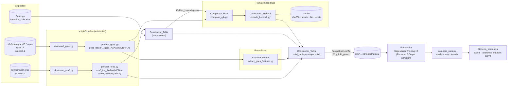
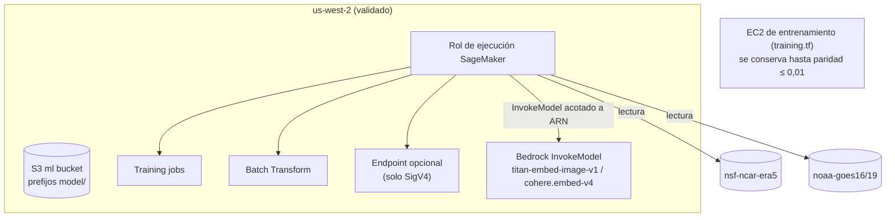

# Design Document — Predictor multimodal de tornados y trombas

## Overview

Este diseño describe cómo construir el predictor multimodal definido en `requirements.md`: un clasificador XGBoost que estima, para cada Celda_Hora de la grilla ERA5 (0,25°, una hora UTC), la probabilidad de que preceda a un Evento del Catálogo en un horizonte de 0 a 3 horas.

El pipeline tiene cinco etapas:

1. **Datos de entrada** (ya existen): `download_era5.py` → `process_era5.py` produce `era5_indices/era5_idx_AAAAMMDD.nc` con los índices en signo austral; `download_goes.py` → `process_goes.py` produce `goes_latlon/AAAAMMDD/goes_AAAAMMDDHH.nc` (hasta 6 barridos por hora, `int16` con `scale_factor`/`add_offset`, `_FillValue = -1`, grilla de 0,02°).
2. **Rama física**: el Extractor_GOES calcula cuatro Variables_GOES por Celda_Hora.
3. **Rama de embeddings**: el Compositor_RGB convierte cada Ventana_GOES en un PNG con una receta versionada, el Codificador_Bedrock lo convierte en un vector (Titan Multimodal Embeddings G1 por defecto, Cohere Embed v4 opcional), y el Reductor (PCA, 8–16 componentes) se ajusta **dentro de cada partición** de la Validación_LOEO.
4. **Compilación (X, y)**: el Constructor_Tabla arma una tabla PU con una fila por Celda_Hora, rezagos t−1/−2/−3 h sin información del futuro, y la escribe en Parquet por Configuración_Experimento. De ahí salen `X` (columnas de variables), `y` (`label`) y `groups` (`fold_group`) para los canales de SageMaker.
5. **Entrenamiento e inferencia en SageMaker**: un trabajo de entrenamiento por configuración (`baseline_era5`, `physical`, `embeddings`) con los mismos hiperparámetros y las mismas particiones; un comparador elige `embeddings` solo si su CSI supera estrictamente al de `physical`; Batch Transform aplica el modelo seleccionado a días nuevos.

### Qué significa "predicción de series de tiempo" aquí

El modelo no es secuencial (ni LSTM ni Transformer). Con ~102 Eventos positivos, una red recurrente sobreajusta. La estructura temporal entra como **variables**: cada fila de hora `t` lleva el valor de cada índice ERA5 y de cada Variable_GOES en `t`, `t−1 h`, `t−2 h` y `t−3 h`, y las diferencias `x(t) − x(t−k)`. Los árboles de XGBoost aprenden umbrales sobre la tendencia (por ejemplo, SRH que se vuelve más negativa, tope que se enfría) además del nivel. La tasa de enfriamiento GOES aporta la escala sub-horaria (15–30 min). El horizonte 0–3 h queda definido por esa ventana de historia: la fila responde "¿esta celda, con esta evolución de las últimas 3 h, corresponde a la hora de un Evento?".

### Decisiones clave

| Decisión | Elección | Motivo |
|---|---|---|
| Modelo | XGBoost con rezagos | Pocos positivos; interpretable; ya existe en `train_xgboost.py` |
| Embeddings | Experimento, no base | Cambio de dominio y pérdida de calibración (ver riesgos en el Documento_Predictor) |
| PCA | Ajuste por partición dentro del trabajo de entrenamiento | Evita fuga del Evento retenido (Req. 5.2) |
| Lógica compartida | Módulos puros en `scripts/model/`, importados por la CLI local y por el trabajo de SageMaker | Paridad exacta script ↔ SageMaker (Req. 7.10, 9.6) |
| Contenedor | Contenedor de XGBoost de SageMaker en *script mode*, con `requirements.txt` que fija la misma versión de `xgboost` que `uv.lock` | Sin mantener imagen propia; misma versión de librería |
| Región ML | us-west-2 con validación en Terraform | Req. 9.3–9.4; región de `nsf-ncar-era5` |
| Formato | Parquet (pyarrow ya es dependencia) | Columnar, tipado, lo lee el contenedor sin dependencias extra |

**Región: decisión tomada.** El equipo acepta us-west-2 para SageMaker y Bedrock (Req. 9.3–9.4) y se encarga de que la cuenta permita crear recursos en esa región antes del `terraform apply`. La nueva variable `ml_region` (us-west-2, validada) es independiente de `training_region` (us-east-1, EC2 de entrenamiento existente) y de `region` (us-east-1, CloudFront). El comentario de `training_region` en `variables.tf` se actualiza para que no contradiga a `ml_region`: indica que esa EC2 sigue en us-east-1 por la restricción histórica de la cuenta y que el flujo de SageMaker usa `ml_region`.

## Architecture

### Flujo de datos



### Orden de ejecución

El orden importa porque el Compositor_RGB y el Codificador_Bedrock solo procesan las Celdas_Hora que entran a la tabla (positivas y muestra no etiquetada), no toda la grilla. Así una corrida con ~102 positivos y 200 no etiquetados por positivo codifica ~20 000 imágenes, no millones.

1. `process_era5.py` y `process_goes.py` (existentes) para los días con Evento y los días extra sin Evento.
2. `extract_goes_features.py`: Variables_GOES de **todas** las Celdas_Hora de cada día (son baratas y se necesitan para los rezagos).
3. `build_table.py --stage select`: etiqueta positivos y muestrea no etiquetados con semilla; escribe `cells.parquet`.
4. `compose_rgb.py --cells cells.parquet`: PNG por Celda_Hora elegida, más su manifiesto.
5. `encode_bedrock.py`: embedding por PNG, con caché.
6. `build_table.py --stage build --config {baseline_era5,physical,embeddings}`: une todo, calcula rezagos y escribe las tres tablas.
7. `launch_sagemaker.py train`: sube tablas y `folds.json`, lanza los tres trabajos y espera.
8. `compare_runs.py`: escribe el reporte comparativo y marca el modelo seleccionado.
9. `launch_sagemaker.py transform --start … --end … --region …`: inferencia por lotes.

### Entrenamiento

```mermaid
sequenceDiagram
    participant U as Usuario
    participant L as launch_sagemaker.py
    participant S3 as S3 ML (us-west-2)
    participant SM as SageMaker Training
    participant J as train_entry.py (contenedor)
    participant C as compare_runs.py

    U->>L: train --run-id R --seed 0
    L->>L: valida tablas (positivos, columnas por config)
    L->>L: compute_folds(tabla) → folds.json (mismo para las 3)
    L->>S3: sube tables/<config>/ y folds.json
    par por cada config
        L->>SM: CreateTrainingJob(config, mismos hiperparámetros)
        SM->>J: canales train + folds
        loop por partición (Evento retenido)
            J->>J: separa train/test por fold_group
            opt config = embeddings
                J->>J: ajusta Reductor solo con train; proyecta test
            end
            J->>J: XGBoost.fit(train) → predict_proba(test) ≥ 0,5
            J->>J: acumula aciertos, omisiones, falsas alarmas
        end
        J->>J: modelo final con toda la tabla (+ Reductor final)
        J->>S3: results/R/<config>/{model.json, metrics.json, importance.json, reporte.html}
        J->>SM: /opt/ml/model → model.tar.gz
    end
    L->>C: estados de los 3 trabajos
    C->>S3: results/R/comparacion.{json,html} (modelo seleccionado)
```

### Infraestructura



## Components and Interfaces

### Distribución de módulos

Siguiendo AGENTS.md: CLIs con `main()` y `common.parser`, salida en `data/...`, `sys.path` con `scripts/`. La lógica pura vive en módulos sin E/S para poder probarla con datos sintéticos y para importarla dentro del contenedor de SageMaker.

```
scripts/model/
  goes_features.py         # puro: decode, valid_mask, window_features, cooling_rate, select_scan
  extract_goes_features.py # CLI del Extractor_GOES
  rgb.py                   # puro: Recipe, RECIPES, normalize, denormalize, compose, to_png_bytes
  compose_rgb.py           # CLI del Compositor_RGB
  bedrock_encoder.py       # BedrockEncoder (cliente inyectable), cache_key, EmbeddingCache
  encode_bedrock.py        # CLI del Codificador_Bedrock
  reducer.py               # puro: Reducer (PCA), save/load .npz
  table.py                 # puro: label_positives, sample_unlabeled, add_lags, config_columns, assign_fold_groups
  build_table.py           # CLI del Constructor_Tabla (--stage select|build)
  loeo.py                  # puro: compute_folds, run_loeo, metrics, select_model
  train_xgboost.py         # CLI existente; ahora delega en table.py y loeo.py
  sm_job/                  # no se llama sagemaker/: con scripts/model en sys.path taparía al SDK
    train_entry.py         # punto de entrada del trabajo de entrenamiento
    inference.py           # model_fn / input_fn / predict_fn / output_fn
    requirements.txt       # xgboost==<misma versión que uv.lock>, pyarrow, scikit-learn
  launch_sagemaker.py      # CLI: train | transform | endpoint
  compare_runs.py          # CLI: reporte comparativo y selección
tests/
  test_goes_features.py  test_rgb.py  test_bedrock_encoder.py
  test_reducer.py        test_table.py  test_loeo.py
infra/terraform/
  sagemaker.tf  (rol, bucket ML us-west-2, políticas)  variables.tf (ml_region con validación)
docs/modelo_predictor.md
```

Dependencias nuevas con `uv add` y versión exacta (Req. 10.6): `boto3==1.43.75` y `sagemaker==3.21.0` (solo para `launch_sagemaker.py`), y `hypothesis==6.169.4` como dependencia de desarrollo para las pruebas de propiedades. Las versiones quedan registradas en `pyproject.toml` y `uv.lock`.

### Extractor_GOES (`goes_features.py`, `extract_goes_features.py`)

```python
FILL_VALUE = -1
COLD_THRESHOLD_K = 213.15
MIN_VALID_FRACTION = 0.5

def decode(raw: np.ndarray, scale: float, offset: float, fill: int) -> np.ndarray:
    """Marca como NaN los valores iguales a ``fill`` y aplica escala y desfase (Req. 2.5)."""

def window_features(bt13: np.ndarray, bt08: np.ndarray) -> dict[str, float]:
    """BT mínima C13, fracción < 213,15 K y máx. (C08 − C13) de una Ventana_GOES ya decodificada.
    Devuelve NaN en todo si los píxeles válidos de C13 son < 50 % del total (Req. 2.6)."""

def cooling_rate(bt_min_early: float, bt_min_late: float, dt_min: float) -> float:
    """(early − late) × 15 / dt_min en K/15 min; NaN si dt_min ∉ [15, 30] o algún mínimo es NaN."""

def select_scan(scan_times: Sequence[dt.datetime], t: dt.datetime) -> int | None:
    """Índice del barrido más reciente con s ∈ (t − 60 min, t]; None si no hay (Req. 6.8–6.9)."""

def select_pair(scan_times: Sequence[dt.datetime], late: int) -> int | None:
    """Barrido anterior con Δt ∈ [15, 30] min respecto de ``late``; prefiere Δt más cercano a 15."""
```

- La CLI abre `goes_latlon` con `mask_and_scale=False` y llama a `decode` explícitamente con los atributos de cada variable (`C08`, `C13`), para no depender de la decodificación automática de xarray.
- Ventana_GOES: cuadrado centrado en el punto ERA5, de lado configurable `--window-deg` (por defecto 0,25°, una celda ERA5, ~13 × 13 píxeles a 0,02°).
- Para la hora `t` lee el archivo de la hora `t` y el de `t−1` (los barridos de `(t−60, t]` pueden estar en el archivo de la hora anterior). Nunca lee barridos con `s > t` (Req. 6.6).
- Si falta `C08` o `C13`, omite el archivo y avisa con archivo y banda (Req. 2.11). Día sin archivos: aviso con fecha y continúa (Req. 2.12).
- Salida: `data/model/<region>/goes_features/goes_feat_AAAAMMDD.parquet`; salta lo existente salvo `--force` (Req. 2.9).

### Compositor_RGB (`rgb.py`, `compose_rgb.py`)

```python
@dataclass(frozen=True)
class Channel:
    expr: str          # "C13" o "C08-C13"
    lower_k: float
    upper_k: float     # lower_k < upper_k
    fill: int          # 0..255

@dataclass(frozen=True)
class Recipe:
    name: str
    version: int
    channels: tuple[Channel, Channel, Channel]

RECIPES: dict[tuple[str, int], Recipe]   # p. ej. ("ir_wv", 1), ("airmass", 1)

def validate_recipe(name: str, version: int) -> Recipe:            # Req. 3.10
def normalize(bt: np.ndarray, ch: Channel) -> np.ndarray:          # uint8; clip + lineal + round (Req. 3.3)
def denormalize(q: np.ndarray, ch: Channel) -> np.ndarray:         # inversa lineal
def compose(bands: dict[str, np.ndarray], recipe: Recipe, size: int) -> ComposeResult
def to_png_bytes(rgb: np.ndarray) -> bytes                          # Pillow, sin metadatos, compress_level fijo
```

Recetas iniciales (v1; los límites se documentan en el Documento_Predictor):

| Receta | R | G | B |
|---|---|---|---|
| `ir_wv` v1 (defecto) | C13 [183,15; 303,15] K | C08 [193,15; 263,15] K | C08−C13 [−80; 10] K |
| `airmass` v1 | C08−C10 [−26,2; 0,6] K | C12−C13 [−43,2; 6,7] K | C08 [208,5; 243,9] K |

- Redondeo: `np.rint` (mitad a par), estable y determinista.
- Remuestreo: vecino más cercano (`Image.NEAREST`) al lado `--size` (224 a 1024, por defecto 224). No interpola, así que no crea valores nuevos; la propiedad de ida y vuelta se verifica antes del remuestreo (Req. 3.4).
- Ventana para imágenes: `--window-km` (por defecto 100 km), mayor que la celda para dar contexto a un modelo entrenado con fotos de ≥ 224 px.
- Determinismo (Req. 3.5): PNG sin bloques de texto ni fecha, `optimize=False`, `compress_level=6`. Los metadatos van en un manifiesto aparte, no en el PNG.
- Salida: `data/model/<region>/rgb/<recipe>_v<version>/AAAAMMDD/<cell_id>.png` y `manifest.parquet` (Req. 3.7), más `skipped.parquet` con motivo (Req. 3.8–3.9).

### Codificador_Bedrock (`bedrock_encoder.py`, `encode_bedrock.py`)

```python
MODELS = {
    "titan": ModelSpec("amazon.titan-embed-image-v1", default_dim=1024, allowed_dims=(256, 384, 1024)),
    "cohere-v4": ModelSpec("cohere.embed-v4:0", default_dim=1536, allowed_dims=(256, 512, 1024, 1536)),
}

def cache_key(png: bytes, model_id: str, dim: int, recipe_version: str) -> str:
    """sha256(png) + model_id + dim + receta → clave estable (Req. 4.5)."""

class EmbeddingCache(Protocol):
    def get(self, key: str) -> np.ndarray | None: ...
    def put(self, key: str, vec: np.ndarray) -> None: ...

class BedrockEncoder:
    def __init__(self, client: BedrockRuntimeLike, control: BedrockControlLike, spec: ModelSpec,
                 dim: int, cache: EmbeddingCache, sleep: Callable[[float], None] = time.sleep) -> None: ...
    def preflight(self, region: str) -> None:            # Req. 4.4: falla antes de la 1.ª imagen
    def encode(self, png: bytes, recipe_version: str, force: bool) -> EncodeResult: ...
    def run(self, items: Iterable[ImageItem], force: bool) -> RunSummary: ...
```

- `preflight` llama a `bedrock.get_foundation_model` (plano de control) y, si falla por modelo inexistente o sin acceso, termina con código ≠ 0 nombrando modelo y región, sin tocar la caché.
- Cuerpo de la solicitud: solo la imagen en base64 y los parámetros del modelo (`embeddingConfig.outputEmbeddingLength` en Titan; `input_type`, `embedding_types`, `output_dimension` en Cohere). Nada del Catálogo (Req. 4.9).
- Reintentos: `ThrottlingException` → esperas 1, 2, 4, 8 y 16 s; después, fallida (Req. 4.7). Otros errores y `ReadTimeout` de 30 s (`botocore.config.Config(read_timeout=30, retries={"max_attempts": 0})` para que no reintente botocore por su cuenta) → fallida con tipo de error (Req. 4.10).
- Validación de la respuesta: longitud = `dim` y todos finitos; si no, fallida y sin caché (Req. 4.11).
- `sleep` inyectable para que las pruebas verifiquen las esperas sin dormir.
- Caché: `LocalCache` (`data/model/embeddings/cache/<key>.npy`) o `S3Cache` (`s3://…-ml/model/embeddings/cache/<key>.npy`). Escritura atómica (`.tmp` + rename) para no dejar entradas a medias.
- Salida: `data/model/<region>/embeddings/<model>_<dim>_<recipe>_v<version>.parquet` (`cell_id`, `emb_0000…`) y `run_summary.json` con `encoded`, `cached`, `failed`, `model_id` (Req. 4.3, 4.8). Código de salida ≠ 0 si `failed > 0`.
- Dónde corre: desde la máquina local o EC2 con credenciales del usuario, o como SageMaker Processing job con el rol de ejecución (que tiene `bedrock:InvokeModel` acotado).

### Reductor (`reducer.py`)

```python
class Reducer:
    def __init__(self, n_components: int, model_id: str) -> None:   # valida 8 ≤ n ≤ 16 (Req. 5.6)
    def fit(self, emb: np.ndarray) -> "Reducer":                    # excluye filas con NaN (Req. 5.8)
    def transform(self, emb: np.ndarray) -> np.ndarray:             # N × n; NaN en filas inválidas
    def explained_variance(self) -> tuple[list[float], list[float]] # por componente y acumulada (Req. 5.4)
    def save(self, path: Path) -> None                              # .npz: mean, components, ratio, n, model_id, dim
    @classmethod
    def load(cls, path: Path) -> "Reducer"
```

PCA propia sobre NumPy (SVD de la matriz centrada, signo fijado para que el mayor valor absoluto de cada componente sea positivo). Así el resultado es determinista, se guarda en `.npz` sin pérdida (float64) y la ida y vuelta es exacta. scikit-learn ya es dependencia y sirve como modelo de referencia en las pruebas.

### Constructor_Tabla (`table.py`, `build_table.py`)

```python
CONFIGS = ("baseline_era5", "physical", "embeddings")
ERA5_FEATURES = FEATURES  # las 12 de train_xgboost.py, signo austral sin modificar
GOES_FEATURES = ("goes_bt13_min", "goes_cold_frac", "goes_wv_ir_max", "goes_cooling_rate")
LAGS = (1, 2, 3)

def label_positives(catalog: pd.DataFrame, lat: np.ndarray, lon: np.ndarray,
                    region: common.Region) -> tuple[pd.DataFrame, Skipped]:
def sample_unlabeled(candidates: pd.DataFrame, n_pos: int, ratio: int, seed: int) -> pd.DataFrame:
def add_lags(hourly: pd.DataFrame, cols: Sequence[str]) -> pd.DataFrame:
def assign_fold_groups(table: pd.DataFrame, seed: int) -> pd.Series:
def config_columns(config: str, n_emb: int) -> list[str]:
def build(config: str, ...) -> pd.DataFrame:
```

- **Etiquetado** (Req. 6.2, 6.10–6.12): hora del Evento redondeada a la hora entera más cercana; punto ERA5 de menor distancia (distancia en grados con longitud escalada por `cos(lat)`, como `process_goes.nearest_index`); empates → menor latitud, luego menor longitud. Si dos Eventos caen en la misma Celda_Hora, gana el `event_id` menor y los demás se informan. Eventos sin fecha/coordenadas/hora o fuera de la región se omiten e informan.
- **`event_id`**: `AAAAMMDD-<fila del Catálogo>` (formato actual del script), vacío en no etiquetadas.
- **Muestreo** (Req. 6.3): `rng = np.random.default_rng(seed)`; `rng.choice(len(candidates), size, replace=False)` sobre las Celdas_Hora candidatas (todas las de los días procesados, en orden canónico `time, latitude, longitude`), excluyendo las positivas. Si hay menos candidatas que el tamaño pedido, se toman todas y se avisa.
- **Rezagos** (Req. 6.5–6.7): se calculan sobre la serie horaria completa de cada punto (no solo las filas muestreadas) con `groupby([lat, lon]).shift(k)` sobre un índice horario **reindexado sin huecos**, de modo que `shift(k)` es exactamente `t − k h`; si la hora no existe, NaN. Nombres: `<var>_lag{k}` y `<var>_d{k} = <var> − <var>_lag{k}`.
- **Alineación GOES** (Req. 6.8–6.9): las Variables_GOES ya vienen alineadas por el Extractor con `select_scan`; los embeddings se asocian por `cell_id`, que codifica el barrido elegido por la misma función.
- **Grupos de partición** (`fold_group`): ver Data Models.
- **Determinismo** (Req. 6.13): orden final por `(time, latitude, longitude)`, columnas en el orden de `config_columns`, semilla única.
- Etapa `select` escribe `cells.parquet` (las Celdas_Hora y su `fold_group`); etapa `build` la reutiliza para las tres configuraciones, lo que garantiza filas idénticas entre configuraciones.

### Entrenador (`loeo.py`, `sm_job/train_entry.py`, `launch_sagemaker.py`, `compare_runs.py`)

```python
XGB_PARAMS = dict(
    objective="binary:logistic",
    tree_method="hist",
    n_estimators=1000,            # tope; el número real lo fija la parada temprana
    early_stopping_rounds=30,
    eval_metric=["logloss", "aucpr"],  # la última (aucpr) decide la parada temprana
    max_depth=4,
    min_child_weight=5,
    subsample=0.8,
    colsample_bytree=0.8,
    reg_lambda=1.0,
    learning_rate=0.05,
)  # iguales en las tres configuraciones (Req. 7.1); random_state=seed y scale_pos_weight se agregan por partición
INNER_VAL_FRACTION = 0.2
THRESHOLD = 0.5
DEV_DATES = (dt.date(2019, 5, 30), dt.date(2019, 5, 31))

def compute_folds(table: pd.DataFrame) -> list[Fold]:          # un Fold por event_id; marca skipped si train tiene 1 clase
def scale_pos_weight(y: np.ndarray) -> float                    # n_neg / n_pos de la partición de entrenamiento
def inner_split(groups: pd.Series, y: np.ndarray, seed: int) -> tuple[np.ndarray, np.ndarray]
def fit_xgb(X_tr, y_tr, groups_tr, seed) -> XGBClassifier       # partición interna + parada temprana
def run_loeo(table, feats, folds, seed, reducer_factory=None) -> LoeoResult
def metrics(hits: int, misses: int, false_alarms: int) -> dict[str, float]   # 0 si denominador 0
def best_csi_threshold(y: np.ndarray, p: np.ndarray) -> tuple[float, float]  # informativo
def pr_auc(y: np.ndarray, p: np.ndarray) -> float                            # informativo
def select_model(results: dict[str, LoeoResult | Failure]) -> Selection
```

- `run_loeo` recibe la lista de particiones ya calculada (`folds.json`), así las tres configuraciones usan exactamente las mismas (Req. 7.2, 7.13). En cada partición: `train = fold_group != held`, `test = fold_group == held`; con `reducer_factory` (solo `embeddings`) se ajusta el Reductor con las filas de `train` y se proyecta `test` (Req. 5.2).

#### Configuración de XGBoost

Se asume que la tabla de entrenamiento está razonablemente balanceada (la razón de no etiquetadas por positiva se elige en `build_table.py --ratio` para que la desproporción no sea severa). Sobre esa base:

- **Objetivo y algoritmo.** `objective="binary:logistic"` produce probabilidades en [0, 1] (Req. 8.2). `tree_method="hist"` es rápido, determinista con `random_state` fijo y es el método por defecto en las versiones actuales de XGBoost.
- **NaN nativos.** No se imputa. XGBoost aprende en cada división hacia qué rama van los faltantes, lo que es correcto aquí: un rezago sin datos o una Variable_GOES anulada por < 50 % de válidos es información y no debe reemplazarse por una media (Req. 6.7, 8.7).
- **`scale_pos_weight` por partición.** Se calcula como `n_negativas / n_positivas` del conjunto de entrenamiento de cada partición (y del conjunto completo en el modelo final), en vez de un valor fijo. Con datos balanceados vale ≈ 1 y casi no actúa; si la razón cambia, se ajusta sola sin tocar los hiperparámetros compartidos. El valor usado en cada partición se registra en `metrics.json`.
- **Parada temprana sin fuga.** Dentro de cada partición de entrenamiento se separa un conjunto de validación interno con `GroupShuffleSplit(n_splits=1, test_size=INNER_VAL_FRACTION, random_state=seed)` sobre `fold_group`. Así las filas de un mismo Evento quedan todas en entrenamiento interno o todas en validación interna, y el Evento retenido de la partición LOEO nunca participa (ni en el ajuste ni en la parada). Si la validación interna queda sin positivas, se reintenta con `random_state = seed + i` hasta 10 veces; si no se logra, se entrena sin parada temprana con `n_estimators = 300` y se registra. `eval_metric=["logloss", "aucpr"]`: `aucpr` es la última, así que decide la parada (más sensible con pocos positivos que `logloss`). El número de árboles elegido (`best_iteration + 1`) se registra por partición.
- **Modelo final.** Para el modelo que se guarda (`model.json`) se repite la misma partición interna sobre toda la tabla y se usa la misma parada temprana.
- **Regularización para pocos positivos.** `max_depth=4`, `min_child_weight=5` (evita hojas sostenidas por uno o dos positivos), `subsample=0.8`, `colsample_bytree=0.8`, `reg_lambda=1`, `learning_rate=0.05`.
- **Restricciones monótonas: no se aplican.** En entornos HSLC el signo de la relación entre índices y probabilidad varía (por ejemplo, CAPE baja con cizalle alto), y el signo austral de SRH/STP complica fijarlo a priori. Queda como trabajo futuro, documentado en el Documento_Predictor.
- **Umbral y métricas.** El umbral de decisión para POD, FAR y CSI sigue siendo 0,5 (Req. 7.4). Además, sobre las predicciones fuera de partición, `best_csi_threshold` informa el umbral que maximiza el CSI y `pr_auc` el área bajo la curva precisión-exhaustividad (`sklearn.metrics.average_precision_score`). Ambos son informativos: no intervienen en `select_model`. La exactitud no se calcula como métrica de decisión.
- **Mismos hiperparámetros en las tres configuraciones** (Req. 7.1): `XGB_PARAMS` es una constante única; `random_state=seed` y `scale_pos_weight` se derivan de los datos de cada partición con la misma regla.
- **Paridad con `train_xgboost.py`** (Req. 7.10): el script delega en `table.py` y `loeo.py`, así que la corrida local, la EC2 y SageMaker recorren el mismo código y dan los mismos conteos con la misma semilla. Los resultados cambian respecto de corridas históricas del script anterior (300 árboles fijos, sin parada temprana, prueba solo con la fila positiva); el reporte lo indica.
- Métricas de selección: suma de aciertos/omisiones/falsas alarmas de las particiones cuyo Evento retenido **no** es de `DEV_DATES`; las de `DEV_DATES` se reportan aparte como "caso de desarrollo" (Req. 7.8).
- `select_model`: `embeddings` si `csi_emb > csi_phys` (estricto), si no `physical`; sin selección si falta alguno de los dos (Req. 7.7, 7.11).
- `train_entry.py` lee los canales `/opt/ml/input/data/train` y `/opt/ml/input/data/folds`, ejecuta `run_loeo`, entrena el modelo final y escribe:
  - en `/opt/ml/model/`: `model.json`, `feature_columns.json`, `reducer.npz` (solo `embeddings`), `config.json` → SageMaker lo empaqueta en `model.tar.gz` para el Servicio_Inferencia;
  - en `s3://<ml-bucket>/model/results/<run_id>/<config>/`: `model.json`, `metrics.json`, `importance.json`, `reporte.html` (Req. 7.9), con el mismo `_write` del script actual (Content-Type correcto).
- `launch_sagemaker.py train` valida cada tabla antes de lanzar (positivos y columnas requeridas, Req. 7.12), calcula `folds.json`, sube y crea los tres trabajos con `sagemaker.train.ModelTrainer` (SDK v3; `sagemaker==3.21.0` no trae `sagemaker.xgboost`): `training_image=sagemaker.core.image_uris.retrieve("xgboost", region=ml_region, version="3.0-5")`, `source_code=SourceCode(source_dir="scripts/model", entry_script="sm_job/train_entry.py", requirements="sm_job/requirements.txt")`, `compute=Compute(instance_type="ml.m5.xlarge", instance_count=1)`, `hyperparameters={"config", "seed", "n-components"}` y canales `InputData("train")`/`InputData("folds")`. `source_dir="scripts/model"` lleva los módulos puros al contenedor.
- `train_xgboost.py` conserva `--indices`, `--catalog`, `--out`, `--seed` y sus cuatro salidas, pero arma la tabla con `table.py` (configuración `baseline_era5`) y evalúa con `loeo.py`. Así la corrida local, la EC2 de `training.tf` y SageMaker ejecutan el mismo código (Req. 7.10, 9.6).

### Servicio_Inferencia (`sm_job/inference.py`, `launch_sagemaker.py transform|endpoint`)

```python
def model_fn(model_dir: str) -> Bundle            # carga model.json, feature_columns.json, reducer.npz
def input_fn(body: bytes, content_type: str) -> pd.DataFrame   # application/x-parquet
def predict_fn(df: pd.DataFrame, bundle: Bundle) -> pd.DataFrame
def output_fn(pred: pd.DataFrame, accept: str) -> bytes        # text/csv
```

- `predict_fn` primero llama a `validate_schema(df, bundle.columns)`: si falta alguna columna requerida lanza `MissingColumnsError` con **todas** las faltantes y no devuelve nada (Req. 8.3). Los NaN en columnas presentes se pasan tal cual a XGBoost, que los trata como faltantes (Req. 8.7).
- Salida por fila, en el orden de entrada: `probability, date, hour_utc, latitude, longitude, config` (Req. 8.1–8.2).
- `transform` construye la tabla de inferencia (todas las Celdas_Hora de `--start`–`--end` en `--region`, sin etiquetas) con `build_table.py --stage infer`, la sube por día y crea el trabajo con el `model.tar.gz` del modelo seleccionado en `comparacion.json` (Req. 8.6). Cada corrida escribe en `model/inference/<run_id>/` nuevo, de modo que un fallo no toca corridas anteriores (Req. 8.8).
- `endpoint` (opcional) despliega un endpoint privado: se invoca solo con `sagemaker-runtime:InvokeEndpoint` firmado con SigV4; no se crea API Gateway, URL pública ni política que permita principales anónimos (Req. 8.4). El documento incluye el comando de borrado.
- Para `embeddings`, la inferencia requiere embeddings de todas las Celdas_Hora del rango, con costo de Bedrock proporcional (orden de 100 000 Celdas_Hora por día en `south-central-austral`). Se documenta y se recomienda usar `physical` salvo que `embeddings` gane.

### Infraestructura (`infra/terraform/sagemaker.tf`)

- Proveedor `aws.ml` con `region = var.ml_region`; `variable "ml_region"` con `default = "us-west-2"` y `validation { condition = var.ml_region == "us-west-2"; error_message = "SageMaker y Bedrock deben ir en us-west-2 (región de nsf-ncar-era5)." }` (Req. 9.4).
- `aws_s3_bucket.ml` en us-west-2, cifrado, bloqueo de acceso público, prefijos `model/`.
- `aws_iam_role.sagemaker_exec` (asume `sagemaker.amazonaws.com`) con políticas inline:
  - `s3:GetObject`, `s3:PutObject` en `arn:aws:s3:::<ml>/model/*` y en el prefijo del Catálogo del bucket de datos; `s3:ListBucket` en esos buckets con condición `s3:prefix`;
  - `s3:GetObject`, `s3:ListBucket` en `nsf-ncar-era5`, `noaa-goes16`, `noaa-goes19`;
  - `bedrock:InvokeModel` en `arn:aws:bedrock:us-west-2::foundation-model/amazon.titan-embed-image-v1` y, si `var.enable_cohere`, `…/cohere.embed-v4:0`.
  - `logs:CreateLogGroup`, `logs:CreateLogStream`, `logs:PutLogEvents`, `logs:DescribeLogStreams` en `arn:aws:logs:us-west-2:<cuenta>:log-group:/aws/sagemaker/*` (y sus `log-stream:*` dentro de ese grupo);
  - `cloudwatch:PutMetricData` con `Resource = "*"` (AWS no admite otro recurso para esta acción) y condición `StringLike { "cloudwatch:namespace" = "/aws/sagemaker/*" }`. Es la única declaración con recurso `*` y queda como excepción explícita del Req. 9.2.
  - Ninguna acción con `*`, ninguna acción `iam:*`, `s3:DeleteBucket` ni `s3:PutBucketPolicy` (Req. 9.2).
- **Brecha con el Req. 9.1: resuelta.** El Req. 9.1 ahora incluye los permisos de CloudWatch Logs acotados a `/aws/sagemaker/*` y `cloudwatch:PutMetricData` con condición de espacio de nombres, y el Req. 9.2 declara esa excepción. Las imágenes de XGBoost propiedad de AWS no requieren permisos de ECR en el rol (si se cambiara a imagen propia en ECR, sí harían falta y `ecr:GetAuthorizationToken` exige recurso `*`).
- Reproducibilidad (Req. 9.5): sin `timestamp()` ni valores no deterministas en recursos; los trabajos, modelos y transformaciones los crea el SDK, no Terraform, así que no generan deriva en `plan`.
- `training.tf` no se toca hasta cumplir la paridad (Req. 9.6). La comprobación la hace `compare_runs.py --ec2-metrics s3://…/resultados/metrics.json`, que informa la diferencia absoluta de POD, FAR y CSI.

### Documento_Predictor (`docs/modelo_predictor.md`)

Contenido mínimo, mapeado al Req. 1: objetivo (1.2), mesociclón ≠ tornado (1.3), etapas (1.4), PU/LOEO/métricas con fórmulas y enlaces a 6.1–6.3 (1.5), cinco riesgos de embeddings con mitigación (1.6), justificación de rezagos con ~102 Eventos (1.7), convenciones australes (1.8), umbrales HSLC de 3.2 (1.9), sin corrección de paralaje (1.10), diagrama en texto (1.11), comandos por componente (1.12), costos con fecha de consulta (9.7), recursos y borrado (9.8), uso para candidatos y ERA5 no operativo (8.5). README.md gana un enlace relativo (1.13).

## Data Models

### Identificadores

- `cell_id`: `AAAAMMDDHH_<lat:+07.2f>_<lon:+07.2f>` (p. ej. `2019053018_-37.25_-072.50`). Único por Celda_Hora; estable entre corridas.
- `event_id`: `AAAAMMDD-<índice de fila del Catálogo>`; cadena vacía en no etiquetadas.
- `fold_group`: partición de la Validación_LOEO a la que pertenece la fila.
  - Positivas: `fold_group = event_id`.
  - No etiquetadas de un día con Eventos: se reparten entre los Eventos de ese día de forma determinista (`hash(cell_id, seed) mod n_eventos_del_día`).
  - No etiquetadas de días sin Evento: se reparten entre todos los Eventos con la misma función.
  - Así cada partición prueba con su positivo y con no etiquetadas retenidas, y FAR deja de ser 0 por construcción. El script actual prueba solo la fila positiva (sus falsas alarmas siempre valen 0): es un cambio de comportamiento que el reporte debe mencionar al comparar con resultados anteriores.

### Variables_GOES por Celda_Hora (`goes_feat_AAAAMMDD.parquet`)

| Columna | Tipo | Unidad | Descripción |
|---|---|---|---|
| `time` | timestamp[ns, UTC] | — | hora `t` de la Celda_Hora |
| `latitude`, `longitude` | float64 | ° | punto ERA5 |
| `scan_start` | timestamp, nulo | — | barrido usado, `s ∈ (t−60, t]` |
| `goes_bt13_min` | float32 | K | BT mínima C13 |
| `goes_cold_frac` | float32 | 1 | fracción de C13 < 213,15 K |
| `goes_wv_ir_max` | float32 | K | máx. C08 − C13 |
| `goes_cooling_rate` | float32 | K/15 min | positivo = se enfría |
| `valid_frac_c13` | float32 | 1 | fracción válida de C13 en la ventana |

### Manifiesto RGB (`manifest.parquet`)

`cell_id, png_path, sha256, recipe, recipe_version, scan_start, window_km, size_px, scale_px_per_px, missing_frac`.

### Embeddings

- Caché: `<cache_key>.npy` (float32, longitud `dim`). `cache_key = sha256(f"{sha256_png}|{model_id}|{dim}|{recipe}_v{version}")`.
- Tabla: `cell_id, model_id, dim, emb_0000 … emb_{dim−1}`.
- `run_summary.json`: `{"model_id", "dim", "encoded", "cached", "failed", "failures": [{"cell_id", "error_type"}]}`.

### Reductor (`reducer.npz`)

`mean (dim,)`, `components (n, dim)`, `explained_variance_ratio (n,)`, `n_components`, `model_id`, `input_dim`.

### Tabla multimodal (X, y, groups)

Columnas clave, comunes a las tres configuraciones: `cell_id, time, date, hour_utc, latitude, longitude, label (int8), event_id, fold_group`.

| Configuración | Columnas de variables (`X`) |
|---|---|
| `baseline_era5` | 12 índices ERA5 en `t` (`cape, shear_01, shear_03, shear_06, srh_01, srh_03, lcl, gamma_03, gamma_75, vgp_01, stp_lm, sherbs3`) |
| `physical` | ERA5 en `t` + 4 Variables_GOES en `t` + para cada una de esas 16: `_lag1..3` y `_d1..3` → 16 × 7 = 112 columnas |
| `embeddings` | `physical` + `emb_0000 … emb_{dim−1}` crudos; la proyección `pca_00 … pca_{n−1}` se calcula dentro de cada partición y en el modelo final |

Decisión: `baseline_era5` mantiene las 12 columnas en `t` sin rezagos para conservar la paridad con el script actual (Req. 7.10). Los rezagos son parte de `physical`, que es la referencia frente a la que se juzga `embeddings`.

- `y = label`; `groups = fold_group`. En el contenedor: `X = table[feature_columns]`, `y = table["label"]`, `groups = table["fold_group"]`.
- Almacenamiento local: `data/model/<region>/tables/config=<config>/date=AAAA-MM-DD/part-0.parquet` (particionado por día y configuración).
- Canal de SageMaker `train`: `s3://<ml>/model/tables/<run_id>/<config>/` con los mismos Parquet (modo `File`); canal `folds`: `s3://<ml>/model/tables/<run_id>/folds.json`.

### `folds.json`

```json
{
  "seed": 0,
  "folds": [
    {"held": "20190530-41", "date": "2019-05-30", "dev": true, "skipped": false},
    {"held": "20210612-77", "date": "2021-06-12", "dev": false, "skipped": false}
  ],
  "n_skipped": 0
}
```

### `metrics.json` (por configuración)

```json
{
  "config": "physical",
  "selection": {"pod": 0.0, "far": 0.0, "csi": 0.0, "hits": 0, "misses": 0, "false_alarms": 0, "n_events": 0},
  "development_case": {"pod": 0.0, "far": 0.0, "csi": 0.0, "hits": 0, "misses": 0, "false_alarms": 0, "n_events": 0},
  "n_folds_skipped": 0,
  "informative": {"pr_auc_oof": 0.0, "best_csi_threshold": 0.5, "best_csi": 0.0},
  "per_fold": [{"held": "…", "scale_pos_weight": 1.0, "best_iteration": 0, "early_stopping": true}],
  "per_event": [{"event_id": "…", "detectado": true}],
  "reducer": {"per_fold": [{"held": "…", "ratio": [], "cumulative": []}]}
}
```

### `comparacion.json`

`{"run_id", "configs": {<config>: {"status": "ok"|"failed", "reason"?, "selection": {...}}}, "selected": "physical"|"embeddings"|null, "rule": "embeddings si CSI > CSI(physical)"}`.

## Correctness Properties

*A property is a characteristic or behavior that should hold true across all valid executions of a system-essentially, a formal statement about what the system should do. Properties serve as the bridge between human-readable specifications and machine-verifiable correctness guarantees.*

La mayor parte del pipeline es lógica pura sobre arreglos y tablas (decodificación, estadísticas de ventana, normalización, PCA, rezagos, particiones, métricas), así que las pruebas de propiedades aplican. Las partes de E/S (Bedrock, SageMaker, Terraform, la documentación) se prueban con ejemplos, dobles de prueba o pruebas de humo. Tras revisar la redundancia del análisis previo se agruparon criterios: por ejemplo, la decodificación (2.5) y las cotas (2.7) quedan dentro de la comparación con un modelo de referencia (Propiedad 1), y los casos de error del Codificador_Bedrock (4.10, 4.11) dentro de la contabilidad de la corrida (Propiedad 10).

### Property 1: Variables_GOES coinciden con el modelo de referencia

*For any* Ventana_GOES sintética de enteros `int16` con `scale_factor`, `add_offset` y píxeles iguales a `_FillValue` en posiciones aleatorias, con al menos 50 % de píxeles válidos en C13, `window_features(decode(...))` devuelve la BT mínima, la fracción bajo 213,15 K y la máxima C08 − C13 iguales a las de una implementación de referencia con máscaras explícitas; además, la BT mínima es ≤ cada BT válida de C13 y la fracción está en [0, 1].

**Validates: Requirements 2.1, 2.2, 2.3, 2.5, 2.7**

### Property 2: Invariancia ante permutación de píxeles

*For any* Ventana_GOES y *for any* permutación de sus píxeles aplicada por igual a C08 y C13, la BT mínima, la fracción bajo −60 °C y la máxima diferencia de bandas no cambian.

**Validates: Requirements 2.8**

### Property 3: Ventanas con pocos píxeles válidos dan NaN

*For any* Ventana_GOES cuya fracción de píxeles válidos de C13 es menor que 0,5, todas las Variables_GOES de esa Celda_Hora son NaN y la fila sigue presente en la salida.

**Validates: Requirements 2.6**

### Property 4: Tasa de enfriamiento

*For any* par de BT mínimas y *for any* separación Δt en minutos, `cooling_rate` es igual a `(anterior − posterior) × 15 / Δt` cuando Δt ∈ [15, 30] y ambas BT son finitas, es positiva si el tope se enfría, y es NaN en cualquier otro caso.

**Validates: Requirements 2.4, 2.10**

### Property 5: Forma de la imagen RGB y relleno de píxeles sin dato

*For any* Ventana_GOES con al menos 50 % de píxeles válidos en las bandas de la receta y *for any* tamaño entre 224 y 1024, `compose` produce un arreglo `uint8` de forma `(size, size, 3)`, y en la matriz normalizada antes del remuestreo cada píxel sin dato vale el `fill` de su canal; la fracción sin dato registrada es igual a la fracción real.

**Validates: Requirements 3.1, 3.6**

### Property 6: Ida y vuelta de la normalización

*For any* arreglo de BT y *for any* canal de receta válido, `denormalize(normalize(bt))` difiere de `bt` en a lo sumo `(upper − lower) / 255` para los valores dentro de `[lower, upper]`, y devuelve `lower` o `upper` para los valores fuera de ese rango.

**Validates: Requirements 3.3, 3.4**

### Property 7: Composición determinista

*For any* Ventana_GOES, receta y tamaño, componer dos veces y codificar a PNG produce bytes idénticos.

**Validates: Requirements 3.5**

### Property 8: La clave de caché distingue sus cuatro componentes

*For any* dos tuplas `(bytes_png, model_id, dim, receta_versión)`, `cache_key` da la misma clave si y solo si las tuplas son iguales (sin colisiones en las muestras generadas).

**Validates: Requirements 4.5**

### Property 9: Idempotencia de la caché

*For any* lista de imágenes y un doble de Bedrock que devuelve vectores válidos, una segunda corrida sin `--force` hace cero llamadas al doble y devuelve vectores idénticos a los de la primera.

**Validates: Requirements 4.6**

### Property 10: Contabilidad de la corrida de codificación

*For any* lista de imágenes y *for any* secuencia de respuestas del doble de Bedrock (vector válido, vector de longitud errónea, vector con NaN, limitación de tasa persistente, otro error, tiempo agotado), `encoded + cached + failed` es igual al número de imágenes; la caché contiene solo vectores de longitud `dim` y finitos; el código de salida es distinto de cero si y solo si `failed > 0`; y cada solicitud enviada contiene solo la imagen y los parámetros del modelo.

**Validates: Requirements 4.1, 4.8, 4.9, 4.10, 4.11**

### Property 11: Forma de la proyección del Reductor

*For any* matriz de embeddings de N filas (N ≥ 1) con la dimensión del ajuste, con filas NaN en posiciones aleatorias, `transform` devuelve exactamente N filas en el mismo orden y `n_components` columnas, con NaN en todas las componentes de las filas inválidas.

**Validates: Requirements 5.3, 5.8**

### Property 12: Varianza explicada acotada

*For any* Reductor ajustado, cada fracción de varianza explicada está en [0, 1] y la fracción acumulada es no decreciente y ≤ 1.

**Validates: Requirements 5.4**

### Property 13: Ida y vuelta de guardar y cargar el Reductor

*For any* Reductor ajustado y *for any* entrada válida, `Reducer.load(save(r)).transform(x)` es igual valor a valor a `r.transform(x)`, y conserva `n_components` y `model_id`.

**Validates: Requirements 5.5**

### Property 14: Número de componentes fuera de rango

*For any* entero fuera de [8, 16], crear el Reductor falla con un mensaje que contiene el valor recibido y el rango, sin escribir archivos.

**Validates: Requirements 5.6**

### Property 15: El Reductor no ve el Evento retenido

*For any* tabla `embeddings` y *for any* partición de la Validación_LOEO, ninguna fila con el `fold_group` retenido está entre las filas usadas para ajustar el Reductor de esa partición.

**Validates: Requirements 5.2**

### Property 16: Etiquetado del punto y hora más cercanos

*For any* grilla ERA5 regular y *for any* Evento con coordenadas dentro de la región y hora UTC, la Celda_Hora positiva coincide con la de una búsqueda exhaustiva de referencia (menor distancia, empates por menor latitud y luego menor longitud, hora redondeada a la más cercana).

**Validates: Requirements 6.2**

### Property 17: Un Evento por positivo

*For any* Catálogo sintético (con Eventos que pueden coincidir en la misma Celda_Hora), cada Celda_Hora positiva tiene exactamente un `event_id`, cada `event_id` incluido aparece en exactamente una positiva, y en cada colisión gana el identificador menor y los demás aparecen en el informe de omitidos.

**Validates: Requirements 6.10, 6.11**

### Property 18: Muestreo de no etiquetadas

*For any* conjunto de candidatas, número de positivas, razón entre 1 y 1000 y semilla, la muestra no tiene repetidos, no contiene positivas y tiene tamaño `min(razón × positivas, candidatas disponibles)`.

**Validates: Requirements 6.3**

### Property 19: Rezagos y diferencias correctos

*For any* serie horaria sintética por punto, con horas faltantes y NaN, `<var>_lag{k}` es el valor en `t − k h` (NaN si esa hora falta o es NaN), `<var>_d{k} = <var> − <var>_lag{k}`, y ninguna fila se elimina.

**Validates: Requirements 6.5, 6.7**

### Property 20: Sin información del futuro

*For any* tabla de entrada y *for any* hora `t`, alterar arbitrariamente los datos ERA5 y GOES con hora o sello de barrido mayor que `t` no cambia ningún valor de las filas de hora `t`.

**Validates: Requirements 6.6**

### Property 21: Selección del barrido GOES

*For any* lista de sellos de barrido y *for any* hora `t`, `select_scan` devuelve el sello máximo dentro de `(t − 60 min, t]`, o `None` si no hay ninguno; en ese caso las Variables_GOES y los embeddings de la fila son NaN.

**Validates: Requirements 6.8, 6.9**

### Property 22: Esquema por configuración y signo austral conservado

*For any* conjunto de entradas sintéticas y *for any* Configuración_Experimento, la tabla tiene una fila por Celda_Hora seleccionada, contiene exactamente las columnas clave más `config_columns(config)`, y los valores de `srh_01`, `srh_03` y `stp_lm` en `t` son idénticos a los de entrada (incluido el signo negativo).

**Validates: Requirements 6.1, 6.4**

### Property 23: Tabla determinista

*For any* conjunto de entradas, configuración y semilla, construir la tabla dos veces produce las mismas filas, en el mismo orden, con las mismas columnas y valores (NaN igual a NaN).

**Validates: Requirements 6.13**

### Property 24: Particiones idénticas entre configuraciones

*For any* selección de Celdas_Hora, `compute_folds` aplicado a las tablas `baseline_era5`, `physical` y `embeddings` produce la misma lista de particiones, con las mismas particiones marcadas como omitidas por tener una sola clase en entrenamiento.

**Validates: Requirements 7.2, 7.13**

### Property 25: Sin fuga en la Validación_LOEO

*For any* tabla y *for any* partición, la intersección entre los `fold_group` (y los `event_id`) de entrenamiento y de prueba es vacía, y todas las filas con el `event_id` retenido están en prueba.

**Validates: Requirements 7.3**

### Property 26: Cálculo y cotas de las Métricas

*For any* vector de probabilidades y etiquetas, los aciertos, omisiones y falsas alarmas con umbral ≥ 0,5 coinciden con un conteo de referencia, y *for any* conteos no negativos, POD, FAR y CSI están en [0, 1] y valen 0 cuando su denominador es 0.

**Validates: Requirements 7.4, 7.5**

### Property 27: Exclusión del caso de desarrollo

*For any* conjunto de resultados por partición, las Métricas de selección no cambian si se alteran los resultados de las particiones cuyo Evento es del 30 o 31 de mayo de 2019, y esas particiones aparecen solo en la sección de caso de desarrollo.

**Validates: Requirements 7.8**

### Property 28: Regla de selección del modelo

*For any* par de CSI de `physical` y `embeddings`, el seleccionado es `embeddings` si y solo si `csi_embeddings > csi_physical`; y *for any* resultado donde `physical` o `embeddings` falló, no hay modelo seleccionado y el fallo aparece con su motivo.

**Validates: Requirements 7.7, 7.11**

### Property 29: Salida de inferencia

*For any* tabla de entrada con todas las columnas requeridas (con NaN en posiciones aleatorias), `predict_fn` devuelve una fila por fila de entrada, en el mismo orden, con probabilidad en [0, 1].

**Validates: Requirements 8.2, 8.7**

### Property 30: Rechazo por columnas faltantes

*For any* subconjunto no vacío de columnas requeridas eliminado de la entrada, `predict_fn` lanza `MissingColumnsError` cuyo mensaje nombra exactamente ese subconjunto y no devuelve probabilidades.

**Validates: Requirements 8.3**

### Property 31: Validación interna sin fuga y peso de clase por partición

*For any* tabla y *for any* partición de la Validación_LOEO, la partición interna de `inner_split` usa solo filas del conjunto de entrenamiento de esa partición, los `fold_group` de entrenamiento interno y de validación interna son disjuntos, ninguno es el `fold_group` retenido, y `scale_pos_weight` es igual a `n_negativas / n_positivas` del conjunto de entrenamiento de la partición.

**Validates: Requirements 7.3, 5.2**

## Error Handling

| Situación | Componente | Comportamiento |
|---|---|---|
| Menos de 50 % válidos en C13 | Extractor_GOES | Variables_GOES en NaN, fila conservada |
| Falta C08 o C13 en un archivo | Extractor_GOES | Aviso con archivo y banda, sigue con los demás |
| Día sin `goes_latlon` | Extractor_GOES | Aviso con la fecha, no escribe tabla, sigue |
| Receta o versión inexistente, límites inválidos | Compositor_RGB | `SystemExit` antes de procesar, nombra receta y campo |
| < 50 % válidos o banda faltante | Compositor_RGB | Omite la Celda_Hora y la registra en `skipped.parquet` |
| Modelo no ofrecido o sin acceso | Codificador_Bedrock | `preflight` termina con código ≠ 0, nombra modelo y región, caché intacta |
| `ThrottlingException` | Codificador_Bedrock | 5 reintentos (1–16 s); luego fallida, continúa |
| Otro error o > 30 s | Codificador_Bedrock | Fallida con tipo de error, sin caché, continúa |
| Vector con longitud errónea o no finito | Codificador_Bedrock | Fallida, sin caché |
| `failed > 0` al final | Codificador_Bedrock | Resumen y código ≠ 0 |
| `n_components` fuera de [8, 16] | Reductor | Error con valor y rango, sin escribir |
| Pocas filas válidas o dimensión distinta | Reductor | Error con esperado y recibido, sin proyectar |
| Evento sin datos o fuera de región; colisión de Eventos | Constructor_Tabla | Omite e informa identificadores al terminar |
| Rezago sin datos; sin barrido en `(t−60, t]` | Constructor_Tabla | NaN, fila conservada |
| Tabla sin positivos o sin columnas requeridas | `launch_sagemaker.py` | Termina antes de crear trabajos, nombra config y causa |
| Partición con una sola clase en entrenamiento | `compute_folds` | Omitida en las tres configuraciones; se informa el número |
| Trabajo de SageMaker fallido o con tiempo agotado | `compare_runs.py` | Registra config y motivo (`FailureReason`), conserva el resto, sin selección si falta `physical` o `embeddings` |
| Columnas faltantes en inferencia | `inference.py` | Rechaza la solicitud completa, nombra todas las faltantes |
| Batch Transform fallido | `launch_sagemaker.py` | Informa causa y archivo; salida en prefijo nuevo, corridas previas intactas |
| `ml_region ≠ us-west-2` | Terraform | Falla la validación en `plan` |

Los mensajes al usuario van en español; los nombres de excepciones y campos, en inglés. Los scripts que procesan muchos elementos nunca abortan por un elemento: registran y siguen, y reflejan los fallos en el resumen y en el código de salida.

## Testing Strategy

### Enfoque dual

- **Pruebas de propiedades** (Hypothesis, `uv add --dev hypothesis==<versión exacta>`): una prueba por cada propiedad de la sección anterior, con al menos 100 ejemplos (`@settings(max_examples=100, deadline=None)`), integradas en `unittest` (las funciones `@given` se definen como métodos de `unittest.TestCase`, que Hypothesis admite), para que `python -m unittest discover -s tests` las ejecute en `make check`. No se implementa PBT desde cero.
- **Pruebas de ejemplo**: CLI con directorios temporales (`tempfile.TemporaryDirectory`) y NetCDF sintéticos escritos en la prueba; recetas inválidas; reintentos con `sleep` falso que registra las esperas `[1, 2, 4, 8, 16]`; `preflight` con modelo inexistente; `--force`; Titan por defecto y Cohere seleccionable; contenido de `docs/modelo_predictor.md` (umbrales HSLC iguales a la sección 3.2, enlaces relativos que resuelven, nodos del diagrama) y el enlace del README.
- **Integración y humo** (fuera de `make check`, manuales o en CI con credenciales): una corrida corta de los tres trabajos en SageMaker con un día de datos; Batch Transform sobre un día; `terraform validate`, `terraform plan` con `ml_region=us-east-1` (debe fallar) y `plan` repetido tras `apply` (cero cambios); revisión del plan en JSON para comprobar que las políticas no tienen `*` en acciones; paridad de POD/FAR/CSI ≤ 0,01 entre EC2 y SageMaker.

### Etiquetado de las pruebas de propiedades

Cada prueba lleva un comentario con el formato:

```python
# Feature: multimodal-tornado-predictor, Property 6: Ida y vuelta de la normalización
```

### Mapa de módulos de prueba

| Módulo | Propiedades | Dobles y datos |
|---|---|---|
| `tests/test_goes_features.py` | 1, 2, 3, 4, 21 | arreglos `int16` con semilla fija |
| `tests/test_rgb.py` | 5, 6, 7 | ventanas sintéticas; recetas de `RECIPES` |
| `tests/test_bedrock_encoder.py` | 8, 9, 10 | `FakeBedrockRuntime` y `FakeBedrockControl` programables; `MemoryCache`; `sleep` falso |
| `tests/test_reducer.py` | 11, 12, 13, 14, 15 | matrices aleatorias; scikit-learn PCA como referencia de varianza |
| `tests/test_table.py` | 16, 17, 18, 19, 20, 22, 23 | grillas y catálogos sintéticos en memoria |
| `tests/test_loeo.py` | 24, 25, 26, 27, 28, 31 | tablas sintéticas; XGBoost real con pocas filas y `n_estimators` reducido mediante parámetro de prueba |
| `tests/test_inference.py` | 29, 30 | modelo XGBoost diminuto entrenado en la prueba |

### Restricciones de las pruebas

- No leen `data/`, no abren red y no necesitan credenciales de AWS (Req. 10.3): los clientes de boto3 se inyectan y en las pruebas se sustituyen por dobles; `launch_sagemaker.py` aísla el SDK de SageMaker detrás de una función que la prueba reemplaza.
- Los generadores de Hypothesis cubren los casos límite del análisis previo: ventanas con 0 %, 49 % y 50 % de válidos; series horarias con huecos al inicio; catálogos con Eventos fuera de la región o en la misma Celda_Hora; particiones de una sola clase; vectores con NaN e infinitos.
- Las pruebas de XGBoost usan pocas filas y árboles para que la suite siga siendo rápida.
- `make check` (ruff, formato, pyright `basic`, unittest) debe pasar antes de cada PR.
