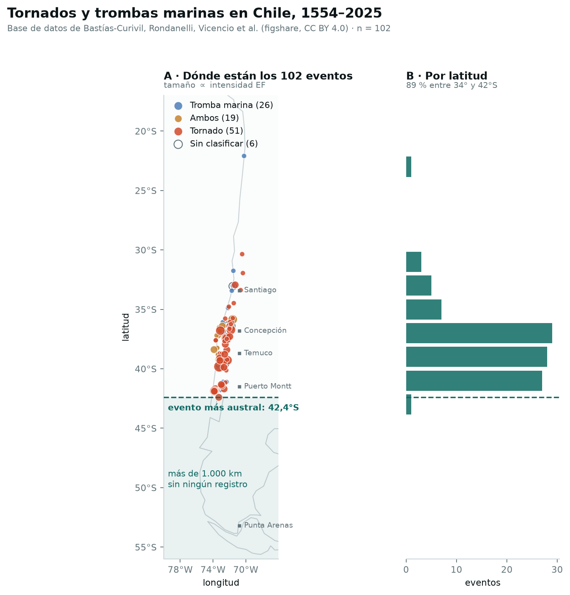
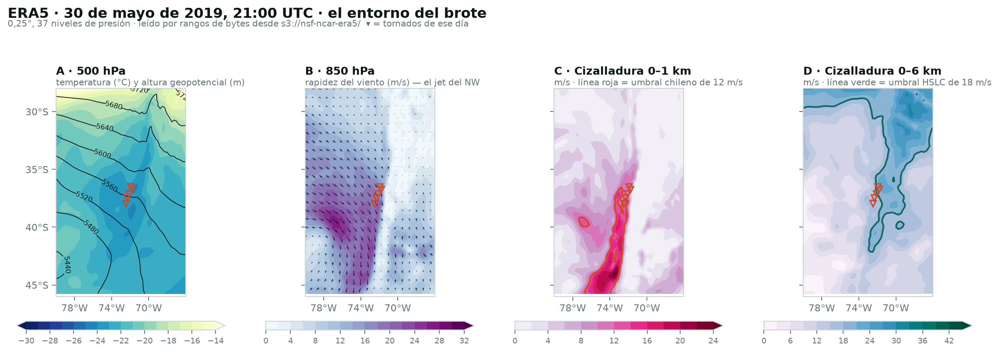
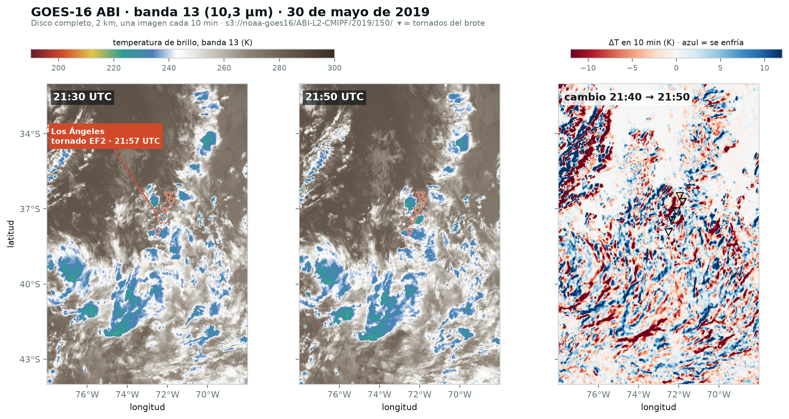
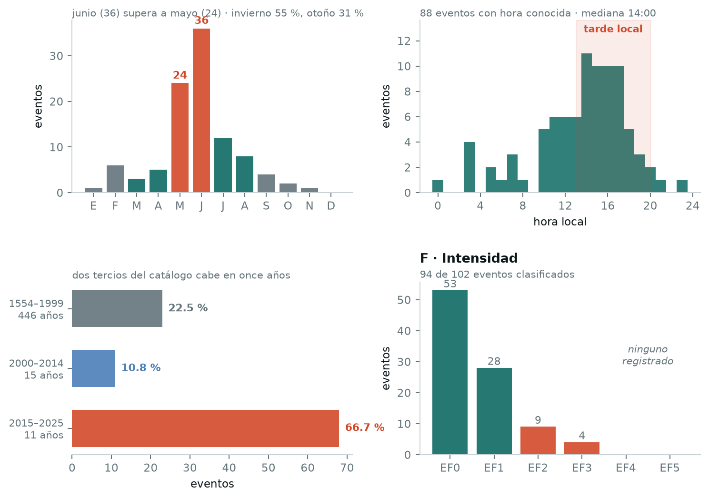

# Predicción de tormentas mesociclónicas en Chile

### Un desafío abierto de datos, física atmosférica y aprendizaje automático

**Proyecto para la hackathon AWS Breaking Barriers** · Documento de contexto, versión 1.0

---

## Índice

1. [El problema en una página](#1-el-problema-en-una-página)
2. [Física: ¿qué es un mesociclón y por qué importa?](#2-física-qué-es-un-mesociclón-y-por-qué-importa)
3. [El caso chileno: un régimen distinto al de las Grandes Llanuras](#3-el-caso-chileno-un-régimen-distinto-al-de-las-grandes-llanuras)
4. [Los datos de entrada](#4-los-datos-de-entrada)
5. [Variables derivadas (*features*) que conviene calcular](#5-variables-derivadas-features-que-conviene-calcular)
6. [Cómo plantear el problema de aprendizaje automático](#6-cómo-plantear-el-problema-de-aprendizaje-automático)
7. [Arquitectura sugerida en AWS](#7-arquitectura-sugerida-en-aws)
8. [Tareas abiertas: por dónde empezar](#8-tareas-abiertas-por-dónde-empezar)
9. [Glosario](#9-glosario)
10. [Referencias y fuentes de datos](#10-referencias-y-fuentes-de-datos)

---

**Cómo leer este documento.** Las secciones 1–3 explican el problema y la física con ejemplos. La sección 4 presenta los datos; la 5, las variables que podemos calcular; y la 6, cómo construir y evaluar un modelo. Las secciones 7–8 proponen una implementación y tareas para los equipos. Puedes volver al glosario de la sección 9 cuando aparezca un término nuevo. Los apartados «Para profundizar» reúnen detalles que puedes dejar para una segunda lectura.

## 1. El problema en una página

En Chile ocurren tornados. El **30 y 31 de mayo de 2019**, dos de ellos afectaron las ciudades de Los Ángeles y Talcahuano–Concepción, en la Región del Biobío. Dejaron daños estructurales, personas heridas y una víctima fatal. El episodio puso de relieve un fenómeno que la comunidad meteorológica chilena venía estudiando: las tormentas del centro-sur pueden producir tiempo severo, como granizo, ráfagas destructivas y tornados, en condiciones distintas a las de las Grandes Llanuras de Estados Unidos.

La base de datos «Tornadoes and Waterspouts in Chile / Tornados y Trombas en Chile» (Bastías-Curivil, Rondanelli, Vicencio et al., figshare, [doi:10.6084/m9.figshare.25119566](https://doi.org/10.6084/m9.figshare.25119566), CC BY 4.0) reúne **102 eventos entre 1554 y 2025**. Hay 70 registros marcados como tornado, 45 como tromba marina y 19 en ambas categorías; esos conteos se solapan (70 + 45 − 19 = 96); los 6 restantes no tienen tipo registrado. De los 102 eventos, 68 corresponden al período 2015–2025. Este catálogo permite comparar datos meteorológicos con eventos documentados, pero su cobertura depende de quién pudo observarlos y registrarlos.

> La ausencia de un registro no permite asegurar que no ocurrió un evento.

Las tormentas sobre el mar, en zonas rurales o durante la noche pueden quedar sin registro. Por ejemplo, una tormenta frente a Valdivia o sobre un bosque en Nahuelbuta puede tener pocos testigos. Por eso, el catálogo podría omitir eventos; su cantidad no se puede establecer con estos datos.

El proyecto propone combinar tres fuentes:

- **Datos meteorológicos:** viento, temperatura y humedad de ERA5, organizados por latitud, longitud, nivel de presión y tiempo. ERA5 reconstruye el estado de la atmósfera del pasado.
- **Imágenes satelitales:** GOES observa las nubes en 16 bandas, que captan distintas partes del espectro electromagnético. En el caso de 2019 contamos con imágenes cada 10 minutos.
- **Etiquetas:** los 102 registros de tornados o trombas marinas, con distintos grados de evidencia. Una etiqueta es la información que usamos para identificar un ejemplo durante el entrenamiento. Aquí los llamaremos casos positivos; no todos confirman la presencia de un mesociclón. Tampoco contamos con casos negativos confiables, es decir, situaciones en las que podamos asegurar que el fenómeno no ocurrió.

El objetivo es estudiar qué condiciones favorecen que una tormenta desarrolle rotación organizada, llamada **mesociclón**. Durante la hackathon, un prototipo puede comparar casos conocidos y seleccionar días y lugares del archivo histórico que merezcan revisión. Condiciones similares a las de un tornado documentado no bastan para confirmar otro evento.

A más largo plazo, se podría explorar un mapa de probabilidades sobre el centro-sur de Chile. Para utilizarlo con horas de anticipación habría que validar sus resultados y contar con datos disponibles a tiempo: ERA5 es una reconstrucción histórica, no una fuente de pronósticos en tiempo real.

---

## 2. Física: ¿qué es un mesociclón y por qué importa?

### 2.1 Definición breve

Un **mesociclón** es una columna de aire en rotación, de entre 2 y 10 km de diámetro, dentro de una tormenta convectiva profunda, donde el aire asciende varios kilómetros. Un tornado tiene una escala menor y su circulación alcanza la superficie. Una tormenta con mesociclón puede producir un tornado, aunque muchas no lo hacen.

Una tormenta con un mesociclón persistente recibe el nombre de **supercélula**. Se distingue de otros tipos de tormenta por la asociación sostenida entre la corriente ascendente y la rotación. Puede producir granizo grande, ráfagas destructivas y tornados intensos.

Estas cifras ayudan a comparar el tamaño y la duración de los fenómenos. Son referencias generales; las tormentas chilenas pueden tener estructuras menos profundas, como veremos en las secciones 3.2 y 3.7:

| Magnitud | Valor típico |
|---|---|
| Diámetro del mesociclón | 2 – 10 km |
| Duración de una supercélula | 2 – 4 horas (casos extremos > 7 h) |
| Duración de un mesociclón individual | decenas de minutos a horas |
| Altura del tope nuboso | 12 – 21 km |
| Fracción de supercélulas que producen tornado | ≤ 30 % |

La última fila recuerda que detectar un mesociclón no basta para anticipar un tornado. Si se usara esa detección como aviso de tornado, se generarían falsas alarmas. La utilidad de un aviso dependerá de cuántos eventos detecte, cuántas falsas alarmas genere y con cuánto tiempo de anticipación llegue.

### 2.2 Los cuatro ingredientes

Para entender cómo se organiza una tormenta severa conviene examinar cuatro ingredientes:

1. **Humedad** en niveles bajos. Es el combustible: el calor latente que se libera al condensar el vapor de agua es lo que alimenta la corriente ascendente.
2. **Inestabilidad**. Si una burbuja de aire levantada desde la superficie se encuentra más cálida (y por tanto menos densa) que su entorno, sigue subiendo sola. La energía disponible para ello se mide con el **CAPE** (*Convective Available Potential Energy*), en joules por kilogramo (J/kg).
3. **Disparo** (*trigger*). Algo tiene que dar el primer empujón hacia arriba: un frente frío, la brisa de mar, una cadena montañosa, la convergencia del viento en superficie.
4. **Cizalladura vertical del viento** (*wind shear*, también llamada cizalle). Es el cambio de la rapidez o de la dirección del viento con la altura. Favorece la organización y la rotación de las supercélulas.

La humedad, la inestabilidad y un mecanismo de ascenso favorecen la formación de tormentas. La cizalladura ayuda a organizarlas y es una variable central del proyecto. La sección 2.5 explica otra vía de formación de tornados que no requiere un mesociclón.

### 2.3 De la cizalladura a la rotación: inclinación y estiramiento

La cizalladura puede contribuir a la rotación de una tormenta mediante inclinación y estiramiento. Entender este mecanismo ayuda a elegir qué variables calcular a partir de ERA5. Los siguientes pasos son un esquema simplificado; en una tormenta real los procesos interactúan.

**Paso 1 — la cizalladura crea vorticidad horizontal.**
Imagina una pequeña rueda de paletas con el eje horizontal. Si el viento sopla más fuerte arriba que abajo, empuja más la paleta superior y la rueda gira. Así podemos representar la **vorticidad horizontal**: la tendencia local del aire a rotar alrededor de un eje paralelo al suelo.

> **Para profundizar: el alcance de la analogía.** Los rodillos que suelen dibujarse en estos esquemas representan una tendencia local a rotar distribuida en el campo de viento. No son tubos físicos separados del aire que los rodea.

**Paso 2 — la corriente ascendente inclina esa rotación hacia la vertical (*tilting*).**
La corriente ascendente inclina parte de esa rotación hacia la vertical. En la analogía, el giro «de rodillo» pasa a ser «de trompo». Esto puede producir zonas de rotación vertical dentro de la tormenta.

**Paso 3 — la convergencia estira la columna y la acelera (*stretching*).**
El aire que converge hacia la base de una columna rotatoria puede estirarla verticalmente e intensificar su giro. La conservación del momento angular ayuda a entenderlo: una patinadora gira más rápido al cerrar los brazos. En la tormenta también intervienen los cambios de presión y el movimiento del aire.

**Paso 4 — la rotación se organiza en un vórtice coherente.**
Cuando la rotación y la corriente ascendente se mantienen asociadas, la tormenta puede desarrollar un mesociclón persistente. Esa asociación caracteriza a una supercélula.

**Para profundizar: la orientación de la rotación.** Importa cómo se orienta la vorticidad horizontal respecto del aire que entra a la tormenta. Cuando está alineada con ese flujo relativo, se denomina *streamwise*; cuando es perpendicular, *crosswise*. La **helicidad relativa a la tormenta (SRH)** resume la componente alineada a lo largo de una capa. Por eso aporta información que la diferencia de viento entre dos alturas no describe por sí sola.

### 2.4 Anatomía de una supercélula

En una supercélula se pueden distinguir zonas de ascenso, descenso y precipitación. Algunas se reconocen desde el suelo o con radar; el satélite muestra sobre todo la parte superior de la nube:

- **Corriente ascendente principal (*updraft*)**: la columna rotatoria. Puede alcanzar 50 m/s en latitudes medias.
- **Base libre de precipitación**: la zona bajo la corriente ascendente donde entra el aire húmedo. Puede caer granizo grande desde un cielo que se ve despejado.
- **Nube pared (*wall cloud*)**: nube baja y rotatoria que cuelga de la base, en la frontera entre el ascenso y el descenso. Cuando una supercélula produce un tornado, suele haber una nube pared que persiste más de diez minutos.
- **FFD (*forward flank downdraft*)**: la corriente descendente del flanco delantero, fría y húmeda, donde está la precipitación más intensa.
- **RFD (*rear flank downdraft*)**: la corriente descendente del flanco trasero. Sus pulsos pueden intervenir en la formación del tornado al interactuar con la rotación y el ascenso cerca del suelo. La distribución de precipitación de una supercélula puede mostrar una forma de gancho en el radar.
- **Yunque (*anvil*)**: la región de la nube que se extiende lateralmente en altura y suele contener cristales de hielo. Se forma cuando el ascenso llega a una capa estable cerca de la tropopausa, el límite entre la troposfera y la estratosfera.
- **Tope penetrante (*overshooting top*)**: una cúpula que sobresale del yunque cuando el ascenso sobrepasa la tropopausa. Puede reconocerse en imágenes satelitales por su relieve o su contraste de temperatura con el entorno. Su detección depende de la resolución y de la geometría de observación.
- **Cap o inversión de bloqueo**: una capa cálida sobre aire frío que impide la convección prematura y permite acumular energía. Si el ascenso supera esa capa, el desarrollo de la tormenta puede acelerarse.

**Tipos de supercélula.** Se clasifican según cuánta precipitación envuelve al mesociclón:

| Tipo | Característica | Riesgo dominante |
|---|---|---|
| **LP** (baja precipitación) | Núcleo de lluvia pequeño y separado del ascenso; aspecto de "sacacorchos" | Granizo grande; tornados raros y débiles; puede no mostrar gancho en el radar |
| **Clásica** | Precipitación "normal", estructura de libro de texto | Todo el espectro; el gancho es claro |
| **HP** (alta precipitación) | La lluvia **envuelve completamente al mesociclón** | Especialmente peligrosa: el tornado queda oculto tras la lluvia; inundaciones y ráfagas |

En un entorno marítimo y húmedo, la precipitación puede dificultar la observación visual de un tornado. Las imágenes satelitales y los datos meteorológicos ayudan a estudiar esas tormentas, aunque tampoco permiten confirmar por sí solos lo que ocurre bajo la nube.

### 2.5 Tornadogénesis: cómo se forma un tornado

La **tornadogénesis** es el proceso de formación de un tornado. No todas sus etapas se comprenden por completo, y existen al menos dos vías que conviene distinguir:

**Vía no supercelular** (*landspouts*, trombas marinas). Requiere un giro preexistente cerca de la superficie — típicamente en una línea de convergencia del viento — y un cumulonimbo encima cuya corriente ascendente estire ese giro hacia arriba. Estos tornados son **generalmente débiles y duran menos de 10 minutos**. Importa para Chile: buena parte de las trombas marinas del litoral probablemente sigue esta vía, que **no requiere mesociclón**, por lo que un modelo centrado en la cizalladura profunda podría dejarla fuera.

**Vía supercelular** (vía mesociclón). La RFD desciende y penetra por detrás en el centro del mesociclón; el aire frío y denso se enrolla en torno a la circulación existente, y la combinación ascenso + descenso concentra la rotación hasta escalas de decenas o centenas de metros. Estos tornados pueden alcanzar gran intensidad y durar más de una hora, aunque su intensidad y duración varían.

El catálogo puede reunir eventos de ambas vías. Distinguirlas ayudaría a definir las etiquetas del modelo, pero requiere evidencia sobre el mecanismo de formación. Saber si un evento ocurrió sobre agua o sobre tierra no basta para determinarlo.

### 2.6 Convenciones de signo en el hemisferio sur

Buena parte de los índices de tormentas severas se desarrolló con casos del hemisferio norte. Al aplicarlos en Chile hay que revisar el sentido de giro, la estimación del movimiento de la tormenta y la convención de signos:

- Un mesociclón ciclónico en Chile gira **en sentido horario** (visto desde arriba), no antihorario.
- La **vorticidad ciclónica es negativa** con la convención matemática habitual.
- La **helicidad relativa a la tormenta (SRH) de los casos tornádicos es negativa**, y las supercélulas tornádicas favorecidas son las ***left-movers*** (que se desvían a la izquierda del viento medio), al revés que en Estados Unidos.
- Los índices compuestos STP, SCP y EHI combinan variables cuyos signos y umbrales deben interpretarse según su formulación. La sección 5.3 los presenta.

> **Qué comprobar al calcular.** En herramientas como MetPy, SHARPpy o wrf-python, revisa las convenciones de signo y la rama de movimiento de la tormenta antes de interpretar un índice. No basta con invertir todos los resultados: la SRH negativa puede ser la señal esperada para una supercélula ciclónica austral. Un error puede cambiar la interpretación del entorno y afectar el entrenamiento. La sección 5.1 explica la estimación *left-mover*.

---

## 3. El caso chileno: un régimen distinto al de las Grandes Llanuras

### 3.1 Chile no aparecía en el mapa

La costa occidental de Sudamérica estuvo poco representada en las descripciones globales de tornados. El «Corredor de los Tornados» sudamericano suele situarse en Argentina central, Uruguay, el sur de Brasil y Paraguay, donde confluyen masas de aire cálido y húmedo del norte y aire frío del sur. Chile tiene una configuración distinta: el Pacífico y los Andes condicionan el movimiento del aire y la disponibilidad de humedad.

El 30 y 31 de mayo de 2019 se produjeron al menos siete tornados en 24 horas entre los 36° y 38°S. Dos de ellos entraron en ciudades:

| | Los Ángeles, Biobío | Talcahuano – Concepción, Biobío |
|---|---|---|
| Fecha y hora | 30 de mayo, 21:57 UTC (≈17:57 local) | 31 de mayo, 18:00 UTC (≈14:00 local) |
| Intensidad (escala Fujita mejorada, de EF0 a EF5) | EF2 | EF1–EF2 |
| Duración | ~8 min | ~15 min |
| Trayecto | ~5,0 km | 17,1 km |
| Viento estimado | 50–60 m/s (218 km/h, informe DMC) | 50–55 m/s (178 km/h, informe DMC) |

Los daños incluyeron una persona fallecida, decenas de heridos, cerca de 500 viviendas dañadas en el Gran Concepción, una nave industrial destruida, camiones volcados y unos 50.000 clientes sin electricidad en Talcahuano. Cayó granizo de 2–3 cm y se acumularon hasta 180 mm de lluvia en dos días.

El tornado de Talcahuano pasó a 400–450 metros de dos estaciones meteorológicas automáticas del aeropuerto Carriel Sur. Los instrumentos registraron una caída de presión de 2,1 hPa en 6 minutos y ráfagas de 24,4 m/s. El registro permitió reconstruir el perfil del vórtice y estimar vientos de 50–55 m/s a unos 80 m del centro, en el radio de viento máximo. La cercanía de las estaciones permitió estudiar la estructura del tornado.

El tornado de Talcahuano nació como tromba marina: un piloto lo reportó sobre el agua antes de que tocara tierra en Caleta El Soldado. Este caso muestra por qué el proyecto también debe estudiar las tormentas sobre el océano y su transición hacia tierra.

### 3.2 El régimen chileno: fuerte cizalladura y bajo CAPE

El caso chileno muestra por qué conviene evaluar los índices con datos locales. Los tornados de las Grandes Llanuras pueden ocurrir con CAPE de varios miles de J/kg. En el brote chileno de 2019 se observaron valores menores, acompañados por un fuerte cambio del viento con la altura.

Durante el brote de 2019, el CAPE más inestable medido y reanalizado estuvo entre 200 y 500 J/kg; los sondeos AMDAR tomados por aviones que aterrizaban en Concepción dieron 673 y 744 J/kg. Estas estimaciones proceden de distintas fuentes y momentos del episodio; no deben interpretarse como una única medición. Los perfiles obtenidos por aviones (AMDAR) son observaciones de temperatura y viento durante el vuelo.

Los estudios describen los siguientes valores del entorno. MUCAPE es el CAPE de la parcela más inestable, SRH mide la helicidad relativa a la tormenta y LCL es el nivel donde el aire que asciende comienza a condensar:

| Parámetro | Valor durante el brote de 2019 |
|---|---|
| MUCAPE | 200 – 1.000 J/kg (bajo) |
| Cizalladura 0–1 km | 12 – 20 m/s (alta) |
| Cizalladura 0–6 km | 18 – 21 m/s (alta) |
| SRH 0–1 km | −100 a −250 m²/s² (parches de −600) |
| SRH 0–3 km | −253 a −688 m²/s² |
| Altura del LCL | < 650 – 713 m (muy bajo) |
| Jet de bajo nivel en 850 hPa | 20 – 25 m/s del noroeste |

Este régimen se denomina HSLC (*High Shear, Low CAPE*): fuerte cizalladura y bajo CAPE. Una definición utilizada es SBCAPE ≤ 500 J/kg, cizalladura 0–6 km ≥ 18 m/s y cizalladura 0–1 km ≥ 10 m/s. SBCAPE toma como referencia una parcela de aire de la superficie. También se han estudiado entornos HSLC en el sureste de Estados Unidos en invierno, California, el sur de Australia y las Islas Británicas. Estos casos ofrecen comparaciones útiles para Chile, aunque sus condiciones no son idénticas.

El CAPE de los días tornádicos puede ser bajo frente al de las Grandes Llanuras, pero alto frente al promedio local. A fines de mayo, el CAPE medio en Biobío es de 15–45 J/kg; un valor de 500 J/kg supera ampliamente esa referencia. Para interpretar un índice importa tanto su magnitud como el contexto climático.

El momento del día también importa. En el entorno analizado, la sensibilidad estimada del CAPE al calentamiento superficial fue de aproximadamente +500 J/kg por grado Celsius. Es una referencia del caso, no una regla para cualquier tormenta. Los siete tornados de 2019 ocurrieron entre las 18:00 y las 23:25 UTC, aproximadamente entre las 14:00 y las 19:25 hora local, durante la tarde.

**Qué implica para el modelo.** Según Vicencio et al. (2021), el umbral clásico del Significant Tornado Parameter (STP), un índice que combina varias condiciones meteorológicas, no habría señalado el brote de mayo de 2019. Los criterios propuestos en los estudios chilenos (VGP₀₋₁, SHERBE y STP, que se definen en la sección 5.3) son:

- VGP₀₋₁ = √CAPE × cizalladura₀₋₁ > 0,1 m/s². Los cinco días tornádicos analizados entre 2008 y 2019 superan ese valor; Los Ángeles supera 0,2 (Vicencio et al. 2021). En esta fórmula, la cizalladura se expresa por unidad de altura, como se aclara en la sección 5.3.
- SHERBE ≥ 1 y **STP de la rama *left-mover* ≤ −0,3**. Marín et al. (2024) los sitúan entre los valores extremos de la distribución chilena de 1959–2021. Hay que distinguir el criterio negativo del STP austral del umbral +1 usado en otros contextos.
- La cizalladura de 0–1 km ayuda a distinguir los días tornádicos del entorno habitual. La de 0–6 km puede superar los valores de referencia en áreas extensas durante el invierno y aportar menos capacidad de separación por sí sola.

Estos criterios orientan la comparación con los estudios citados. Antes de usarlos como umbrales de un modelo hay que comprobar las variantes de cada índice y evaluarlos con datos locales.

### 3.3 El entorno atmosférico a gran escala

Los estudios del brote de 2019 y la climatología de Marín et al. (2024) describen varios elementos del entorno sinóptico, es decir, sistemas atmosféricos que abarcan cientos o miles de kilómetros. Para leer los mapas, recuerda que la presión disminuye con la altura: 850 hPa representa niveles bajos y 500 hPa, niveles medios. La altura exacta cambia con el estado de la atmósfera.

1. Una baja presión frente a la costa (~40–43°S, 75–80°W). Puede mantener durante varios días el transporte de aire cálido desde el norte o noroeste hacia los 35–40°S. Ese transporte por el viento se llama *advección cálida*. En 2019, una baja de ~995 hPa permaneció casi inmóvil desde el 28 de mayo.
2. Aire frío en niveles medios, cerca de 500 hPa, que llega tras el paso del frente. Puede aumentar la diferencia de temperatura entre el aire cercano a la superficie y el de altura, favoreciendo la inestabilidad.
3. Corrientes de vientos intensos en altura, llamadas *jets*, cuya configuración puede favorecer el ascenso a gran escala.
4. Un jet de bajo nivel del noroeste, reforzado por el bloqueo del flujo contra los Andes.
5. El 31 de mayo se observó una nube con forma de coma, asociada a una zona de baja presión de menor escala (*mesobaja*). Acompañó una banda de tormentas sobre el océano, separadas unos 50 km, que entraron a tierra sucesivamente.

La figura 3 (sección 4.1) permite localizar dos de estos elementos: el panel A muestra el aire frío en 500 hPa y el B, el viento del noroeste en 850 hPa. Los marcadores sitúan los eventos para compararlos con el entorno.

**Para profundizar.** Los estudios describen perturbaciones de menor extensión, llamadas *ondas cortas*, tras el frente. También pueden intervenir una baja segregada (*cutoff low*, un centro de baja presión aislado de la circulación principal) y un bloqueo anticiclónico al sur de 45°S que divide el jet en dos ramas. En el brote de 2019 se estudió además la posición de la zona inestable respecto de la salida polar de un *jet streak*, un tramo de viento especialmente intenso dentro del jet. Son detalles para interpretar junto con los mapas y las fuentes, más que una lista de requisitos universales.

### 3.4 Cómo influyen los Andes en la cizalladura

Los Andes bloquean parte del flujo del oeste y lo desvían en una dirección paralela a la cordillera. En el caso estudiado, esto favoreció un jet de barrera del nor-noroeste, con vientos de 20–25 m/s en 850 hPa. El cambio del viento entre ese nivel y la superficie aumenta la cizalladura de niveles bajos y puede contribuir a la helicidad.

Marín et al. (2021) evaluaron ese efecto mediante simulaciones con WRF, un modelo atmosférico. Repitieron el caso reduciendo la altura de la topografía al 50 %, 25 % y 0 % de la original. En esas simulaciones, la reducción de la cordillera disminuyó la cizalladura y la SRH. También estudiaron cómo la temperatura superficial del mar modifica la inestabilidad. Los resultados respaldan la importancia del viento de niveles bajos en ese episodio.

Los estudios describen cizalladura 0–1 km de 5–10 m/s sobre el océano y 10–20 m/s tierra adentro, en parte por la distinta fricción sobre agua y tierra. Una tormenta que cruza la costa puede encontrar un entorno más favorable para organizar su rotación. Por eso conviene estudiar la transición mar–tierra en la franja entre 36° y 40°S.

### 3.5 Estacionalidad y geografía de los eventos

Los 102 eventos del catálogo se concentran en otoño e invierno, aunque también hay registros de primavera y verano:

| Estación | Eventos | Fracción |
|---|---:|---:|
| Invierno (jun–ago) | 56 | 54,9 % |
| Otoño (mar–may) | 32 | 31,4 % |
| Primavera (sep–nov) | 7 | 6,9 % |
| Verano (dic–feb) | 7 | 6,9 % |

Y mes a mes:

| Ene | Feb | Mar | Abr | May | Jun | Jul | Ago | Sep | Oct | Nov | Dic |
|---:|---:|---:|---:|---:|---:|---:|---:|---:|---:|---:|---:|
| 1 | 6 | 3 | 5 | 24 | 36 | 12 | 8 | 4 | 2 | 1 | 0 |

- Junio es el mes más frecuente (36 eventos), seguido de mayo (24). Entre ambos concentran el 59 % de todo el catálogo.
- Otoño e invierno suman el 86 % de los eventos.
- El pico está concentrado entre mediados de mayo y mediados de junio — una "temporada de tornados" de aproximadamente cuatro semanas (Caballero-Morán & Rondanelli 2025). La probabilidad se mantiene elevada hasta agosto.

> **Por qué cambian las proporciones.** Vicencio et al. (2021) reportan 46 % en otoño y 43 % en invierno, con mayo como mes máximo, en una recopilación de 43 eventos. La base de figshare contiene más registros y sitúa primero al invierno y a junio. Las proporciones dependen de la muestra y de los criterios del catálogo; conviene indicar qué versión se usa en cada análisis.

Una explicación física de la concentración estacional es la llegada de aire frío en altura sobre el océano y una superficie todavía relativamente cálidos y húmedos. Los estudios citados sitúan el máximo de CAPE a fines de mayo y el de cizalladura a fines de junio. Su combinación favorece un máximo del VGP a comienzos de junio.

En cuanto a la geografía, la base de datos sitúa 55 de los 102 eventos entre 38° y 42°S y 36 entre 34° y 38°S: juntos, el 89 % del catálogo. Por región administrativa encabezan Los Lagos (23), La Araucanía (16) y Biobío (16), seguidas de Ñuble (9), Maule (7) y Los Ríos (7). La mediana de latitud es 38,7°S.



**Figura 1.** Los 102 eventos del catálogo, coloreados por tipo y dimensionados por intensidad EF. La franja inferior sombreada marca los más de mil kilómetros de Chile austral sin un solo registro.

Los extremos geográficos muestran la amplitud de los registros. El evento más austral registrado es una tromba en Meulín, Chiloé (42,4°S) en julio de 2017: no hay un solo registro al sur de los 42,4°S, pese a que más de mil kilómetros de territorio chileno se extienden más allá. Y el más septentrional es Tocopilla (22,1°S), en pleno desierto de Atacama, en agosto de 2020 — un recordatorio de que el fenómeno no está confinado al sur. Las trombas marinas son más típicas del invierno. La climatología de índices identifica dos focos:

- ~38°S, 72°W, entre la Cordillera de la Costa y los Andes — coincide con el máximo de tornados observados.
- ~42,7°S, 74°W, Isla de Chiloé — coincide con el máximo de trombas marinas.

### 3.6 Cómo se distribuyen los registros en el tiempo

El catálogo reúne 102 eventos a lo largo de 471 años, entre 1554 y 2025. Su distribución temporal muestra una concentración de registros recientes:

| Período | Duración | Eventos | Fracción |
|---|---:|---:|---:|
| 1554 – 1999 | 446 años | 23 | 22,5 % |
| 2000 – 2014 | 15 años | 11 | 10,8 % |
| 2015 – 2025 | 11 años | 68 | 66,7 % |

Dos tercios de los eventos del catálogo corresponden a 2015–2025. El período 2000–2025 aporta más registros que los siglos anteriores juntos. Esa distribución describe lo documentado, no necesariamente cómo ha cambiado la frecuencia real de los fenómenos.

La mayor disponibilidad de teléfonos con cámara y redes sociales facilita la documentación. La cantidad de registros depende tanto de los eventos como de la posibilidad de observarlos y reportarlos. También podría haber cambios en la frecuencia real, pero este catálogo por sí solo no permite separar ambos efectos.

Entre los registros históricos se encuentran el de Carelmapu, 14 de mayo de 1633, que destruyó casi por completo un fuerte español y sobre el que el cronista Alonso de Ovalle escribió que cayó granizo "más grueso que balas de mosquete"; y el de Concepción, 27 de mayo de 1934, cuyos daños fueron cubiertos incluso por *The New York Times*. Ambos en mayo.

Caballero-Morán y Rondanelli (2025), al analizar ERA5 entre 1959 y 2021, identificaron zonas del sur austral con condiciones favorables según VGP, cizalladura y helicidad, pero sin eventos documentados. Plantean el subregistro por baja densidad poblacional como explicación. Esas zonas son candidatas para revisar el archivo histórico: los índices por sí solos no confirman que haya ocurrido un tornado.

### 3.7 Cobertura de radar y límites de la alerta

Un radar meteorológico observa la distribución de la precipitación. El efecto Doppler, un cambio de frecuencia asociado al movimiento de las partículas, permite estimar su velocidad hacia el radar o en dirección contraria. Eso ayuda a estudiar la estructura de las tormentas con más detalle que los datos de superficie aislados.

Vicencio et al. (2021) describen a Chile en 2019 como un país sin radares meteorológicos ni un sistema de alerta de tornados. Para reconstruir las tormentas de ese episodio combinaron imágenes GOES-16, detección de rayos, perfiles de aviones comerciales, estaciones de superficie, videos y simulaciones WRF.

El 7 de noviembre de 2025, la Universidad de Valparaíso [anunció la adjudicación de un radar meteorológico móvil](https://www.uv.cl/archivo-noticias-uv/28540-chile-tendra-su-primer-radar-meteorologico-universidad-de-valparaiso-lidera-el-proyecto-que-transformara-la-investigacion-y-la-gestion-climatica-del-pais) mediante Fondequip Mayor. El proyecto contempla trasladarlo según las necesidades de investigación y monitoreo. El anuncio no equivale a la disponibilidad de una red permanente de cobertura nacional.

En entornos HSLC, la rotación puede ser poco profunda y breve, lo que también dificulta su detección con radar. Emitir un aviso de condiciones favorables para una región y anticipar un tornado concreto son tareas distintas: la segunda exige observar y seguir la tormenta con suficiente detalle.

El proyecto puede ayudar a estudiar entornos favorables y seleccionar casos históricos para revisión. Su uso en alertas operativas requeriría validación y fuentes disponibles a tiempo. La latencia de ERA5, explicada en la sección 4.1, permite trabajar con el pasado, pero impide tratarlo como una entrada inmediata para avisos.

---

## 4. Los datos de entrada

Trabajaremos con un reanálisis, imágenes satelitales y un catálogo de eventos. El primero reconstruye el estado de la atmósfera; las imágenes permiten observar la evolución de las nubes; el catálogo aporta los casos documentados. Los datos son públicos y gran parte se encuentra en Amazon S3, un servicio de almacenamiento de archivos. Acceder a datos públicos no significa que todo el procesamiento sea gratuito: hay que considerar cómputo, almacenamiento y transferencias según la ubicación y el tipo de acceso.

### 4.1 ERA5: el estado 4D de la atmósfera

ERA5 es el reanálisis atmosférico global de quinta generación del ECMWF, el Centro Europeo de Predicción Meteorológica a Plazo Medio. [Un reanálisis combina un modelo meteorológico con observaciones del pasado](https://www.ecmwf.int/en/about/media-centre/focus/2023/fact-sheet-reanalysis), como radiosondas, satélites, aviones, boyas y estaciones. Repite el análisis para cada período con un método consistente y produce una reconstrucción de la atmósfera, hora por hora. No es una medición directa ni un pronóstico del futuro.

| Característica | Valor |
|---|---|
| Cobertura temporal | Enero 1940 – presente (extendido en tiempo casi real) |
| Resolución temporal | Horaria |
| Resolución horizontal nativa | ~31 km (0,28125°), espectral T639 |
| Resolución horizontal distribuida | 0,25° × 0,25° (grilla latitud/longitud regular) |
| Niveles verticales | 137 niveles de modelo (híbridos sigma-presión, tope 0,01 hPa); interpolados a 37 niveles de presión (1 – 1000 hPa) |
| Latencia | ~5 días (versión preliminar ERA5T); ~2–3 meses para la versión final |
| Formato | GRIB1/GRIB2 nativo; NetCDF-4 en las copias de AWS |

**Variables relevantes.** En niveles de presión: componentes del viento u, v, w, temperatura t, humedad específica q, geopotencial z, vorticidad potencial. En nivel único: presión a nivel del mar, temperatura y punto de rocío a 2 m, viento a 10 m y 100 m, temperatura superficial del mar, y los índices de estabilidad CAPE y CIN ya calculados por el ECMWF.

**Para profundizar: acceso en AWS.** Un *bucket* es un contenedor de archivos en S3. Para este proyecto necesitamos la copia que incluye datos en altura:

```bash
# ✅ EL BUCKET A USAR — NSF NCAR, región us-west-2
aws s3 ls --no-sign-request s3://nsf-ncar-era5/

# ⚠️ DEPRECADO — solo 18 variables de superficie, sin datos en altura
aws s3 ls --no-sign-request s3://era5-pds/
```

El bucket `era5-pds` está marcado como deprecado y contiene únicamente 18 variables de superficie (viento a 10 m, temperatura a 2 m, presión, oleaje...). No tiene niveles de presión, ni viento en altura, ni CAPE: esa copia no contiene las variables en altura necesarias para este proyecto. La copia mantenida es `nsf-ncar-era5`.

Estructura de claves de `nsf-ncar-era5` (verificada con `ListBucket`):

```
e5.oper.an.pl/            ← análisis en niveles de presión  (u, v, w, t, q, z)
e5.oper.an.sfc/           ← análisis en superficie / nivel único
e5.oper.an.vinteg/        ← integrales verticales
e5.oper.fc.sfc.accumu/    ← pronóstico, acumulaciones (precipitación)
e5.oper.fc.sfc.instan/    ← pronóstico, instantáneas (CAPE, CIN)
e5.oper.fc.sfc.meanflux/
e5.oper.fc.sfc.minmax/
e5.oper.invariant/        ← campos invariantes (orografía, máscara de tierra)
```

con el patrón de nombre:

```
<prefijo>/<AAAAMM>/<prefijo>.<tabla>_<paramID>_<nombre>.<grilla>.<AAAAMMDDHH>_<AAAAMMDDHH>.nc

# ejemplo real:
e5.oper.an.pl/202401/e5.oper.an.pl.128_060_pv.ll025sc.2024010100_2024010123.nc
```

donde `128_060_pv` es tabla GRIB 128 / parámetro 60 / nombre corto `pv`, y `ll025sc` indica grilla 0,25° para campos escalares (`ll025uv` para campos vectoriales).



**Figura 3.** Entorno del 30 de mayo de 2019, reconstruido con ERA5. El panel A muestra temperatura y altura geopotencial en 500 hPa; el B, viento en 850 hPa; el C, cizalladura 0–1 km; y el D, cizalladura 0–6 km. Los marcadores permiten comparar los campos con la ubicación de los tornados. La extensión de valores elevados en el panel D ilustra por qué conviene evaluar la capacidad de cada variable para distinguir los casos, en vez de usarla de forma aislada.

> **Niveles bajo el terreno en el panel C.** En ERA5 el nivel de 1000 hPa está *bajo tierra* sobre los Andes, y sus valores son una extrapolación del modelo. Parte de la franja de cizalladura intensa que sigue el pie de monte es, por tanto, artificio numérico y no viento real. Cualquier cálculo de cizalladura de niveles bajos debe enmascarar los puntos donde la presión de superficie es menor que el nivel usado, o partir del viento a 10 m en lugar de 1000 hPa.

> **Volumen de descarga.** Cada archivo de niveles de presión contiene una variable, un día completo (00–23 UTC), el globo y 37 niveles: aproximadamente 1,36 GB. Descargar 10 años de seis variables completas requiere decenas de terabytes. No hay recorte geográfico del lado del servidor. La lectura por rangos de bytes permite pedir bloques del archivo y recortar después la región de interés; los bytes transferidos dependen de cómo se almacena cada variable. Un bloque puede contener una hora del globo entero, de modo que recortar el recuadro después de leerlo no reduce los bytes transferidos. Se puede trabajar con `xarray`, `fsspec` y `h5netcdf`, o construir índices con `kerchunk`/`virtualizarr`. El recuadro de interés es aproximadamente 17°S–56°S, 80°W–66°W.
>
> El Climate Data Store (CDS) de Copernicus ofrece recorte geográfico del lado del servidor, con una cola de peticiones. Puede ser una alternativa para prototipos pequeños.

**Lo que ERA5 permite estudiar.** Con ~31 km de resolución y datos horarios, ERA5 no resuelve un mesociclón de unos pocos kilómetros. Describe el entorno en el que se desarrolla la tormenta. GOES aporta información sobre la nube y su evolución, con las limitaciones de observación que veremos a continuación. El proyecto busca evaluar qué se puede inferir al combinar ambas fuentes.

### 4.2 GOES: la tormenta vista desde arriba, cada 10 minutos

Los satélites GOES-R (GOES-16 en adelante) son geoestacionarios: mantienen su posición aparente sobre un punto del ecuador. Llevan a bordo el ABI (*Advanced Baseline Imager*), un radiómetro de 16 bandas desde el visible hasta el infrarrojo térmico.

**Qué satélite observa Chile.** GOES-East está ubicado sobre el ecuador a 75,2°W, una longitud cercana a la de Chile. La serie temporal se reparte entre dos satélites:

| Bucket | Período | Estado |
|---|---|---|
| `s3://noaa-goes16/` | Dic 2017 – Abr 2025 | Archivo histórico de GOES-East |
| `s3://noaa-goes19/` | Abr 2025 – presente | GOES-East operacional (desde el 4 de abril de 2025, 15:00 UTC) |
| `s3://noaa-goes18/` | Ene 2023 – presente | GOES-West (~137°W): no sirve para Chile |
| `s3://noaa-goes17/` | congelado (Ene 2023) | fuera de servicio |

Todos en la región us-east-1.

**Las 16 bandas del ABI.** La longitud de onda central (λ) indica qué parte del espectro observa cada banda. Se expresa en micrómetros (µm); IR significa infrarrojo. Las resoluciones de la tabla son nominales y empeoran hacia los bordes de la imagen:

| Banda | λ central (µm) | Tipo | Apodo | Resolución |
|---|---|---|---|---|
| 1 | 0,47 | Visible | Azul | 1 km |
| 2 | 0,64 | Visible | Rojo | 0,5 km |
| 3 | 0,86 | IR cercano | "Veggie" | 1 km |
| 4 | 1,37 | IR cercano | Cirros | 2 km |
| 5 | 1,6 | IR cercano | Nieve/hielo | 1 km |
| 6 | 2,2 | IR cercano | Tamaño de partícula | 2 km |
| 7 | 3,9 | IR | Ventana de onda corta | 2 km |
| 8 | 6,2 | IR | Vapor de agua, nivel alto | 2 km |
| 9 | 6,9 | IR | Vapor de agua, nivel medio | 2 km |
| 10 | 7,3 | IR | Vapor de agua, nivel bajo | 2 km |
| 11 | 8,4 | IR | Fase del tope nuboso | 2 km |
| 12 | 9,6 | IR | Ozono | 2 km |
| 13 | 10,3 | IR | Ventana larga "limpia" | 2 km |
| 14 | 11,2 | IR | Ventana larga | 2 km |
| 15 | 12,3 | IR | Ventana larga "sucia" | 2 km |
| 16 | 13,3 | IR | CO₂ | 2 km |

Las bandas que más importan para convección severa son la 2 (textura y sombras del tope, solo de día), las 8/9/10 (vapor de agua: revelan la circulación de niveles medios-altos aunque no haya nubes), la 13 (temperatura de brillo del tope: el termómetro de qué tan alto llegó la tormenta) y las diferencias entre bandas, como 13−11 y 13−16, que ayudan a estudiar las propiedades del tope. La temperatura de brillo es la temperatura equivalente inferida de la radiación; su interpretación depende de qué observa el píxel.

**Frecuencia de observación.** En el Modo 6 (operacional desde 2019): disco completo cada 10 minutos, CONUS cada 5 min, dominios de mesoescala cada 60 s. Chile está cubierto por el disco completo, es decir, una imagen cada 10 minutos, 144 por día, las 24 horas. Esta es la resolución temporal que hace posible ver *cómo evoluciona* una tormenta.



**Figura 4.** Temperatura de brillo de la banda 13 a las 21:30 y las 21:50 UTC, separadas por veinte minutos; los triángulos marcan los tornados de ese día. El tercer panel muestra el cambio entre las 21:40 y las 21:50 UTC. Los pares de zonas rojas y azules pueden deberse al desplazamiento de las nubes, por lo que una diferencia entre imágenes no mide solo su desarrollo. Estimar el movimiento con flujo óptico puede ayudar a distinguir desplazamiento y cambio de la nube.

Estructura de claves:

```
<Producto>/<Año>/<DíaDelAño>/<Hora>/<Archivo>

# ejemplo:
OR_ABI-L1b-RadF-M3C02_G16_s20171671145342_e20171671156109_c20171671156144.nc
   │                │   │  │              │              └─ creación del archivo
   │                │   │  │              └─ fin del barrido
   │                │   │  └─ INICIO del barrido: 2017, día 167, 11:45:34,2 UTC
   │                │   └─ satélite (G16/G19)
   │                └─ M3 = modo de barrido, C02 = banda 2
   └─ F = disco completo, C = CONUS, M1/M2 = mesoescala
```

> Trampa práctica: el directorio se organiza por hora de observación, pero el sello `c` (creación) puede caer en la hora siguiente. Filtrar siempre por el campo `s`, nunca por `c`.

**Productos para explorar:**

- `ABI-L2-MCMIPF` — *Multiband Cloud and Moisture Imagery, Full Disk*: las 16 bandas calibradas en un solo archivo. Evita descargar un archivo `CMIPF` separado para cada banda y es un punto de partida para explorar varias bandas juntas.
- `ABI-L2-ACHAF` — altura del tope nuboso. Se utiliza para estimar la corrección de paralaje, explicada más abajo.
- `ABI-L2-ACTPF` — fase del tope nuboso (hielo/agua).
- `ABI-L2-DSIF` — índices de estabilidad derivados (CAPE, índice de levantamiento, agua precipitable) estimados desde el satélite. Un contraste independiente de ERA5.
- `ABI-L2-DMWF` — vientos derivados del movimiento de las nubes. Es una observación real de viento en altura, con resolución mucho mayor que ERA5.
- `GLM-L2-LCFA` — rayos. Archivos cada 20 segundos (180 por hora).
- `ABI-L1b-RadF` — radiancias crudas, si se quiere control total de la calibración.

**Geometría de observación y paralaje.**

El GOES-East está sobre el ecuador, y Chile se extiende hasta los 56°S. El ángulo cenital, medido entre la vertical local y la dirección al satélite, crece con la latitud:

| Lugar | Latitud aprox. | Ángulo cenital | Consecuencia |
|---|---|---|---|
| Arica | 18°S | ~20° | geometría cómoda |
| Santiago | 33°S | ~40° | paralaje ~10 km en un tope de 12 km |
| Chiloé | 42°S | ~50° | píxel efectivo notoriamente alargado |
| Punta Arenas | 53°S | ~60° | píxel IR de 2 km se comporta como ~2 × 4 km; paralaje ~21 km en un tope de 12 km |

Dos efectos concretos:

2. Paralaje. El tope de una tormenta está a 12–15 km de altura, y el satélite lo ve *de lado*. El tope aparece desplazado respecto de su posición real en superficie, en dirección contraria al punto subsatelital (el punto de la Tierra que queda justo bajo el satélite, en 0°, 75,2°W). Como Chile continental queda casi al sur de ese punto, el tope se corre hacia el sur, con una pequeña componente hacia el este. La distancia es aproximadamente `h · tan(θ)`, donde `h` es la altura del tope y `θ` el ángulo cenital local (el ángulo entre la vertical del lugar y la línea de visión del satélite). Para un tope de 12 km, el desplazamiento es de unos 10 km en Santiago (33°S), 13 km a 40°S y 21 km a 53°S. Eso equivale a varias celdas de la grilla de 2 km de GOES. Superponer una imagen GOES con la posición de un tornado reportado, o con la grilla de ERA5, sin corregir el paralaje introduce un error sistemático comparable o mayor que el tamaño de un mesociclón (2–10 km).

> Recomendación: aplicar corrección de paralaje explícita usando la altura de tope de `ABI-L2-ACHAF` junto con los parámetros de la proyección (`goes_imager_projection`, presente en cada archivo NetCDF) y el punto subsatelital (0°, 75,2°W). No tratar la lat/lon de la grilla fija como geolocalización en superficie.

También hay que notar que el GLM (detector de rayos) declara cobertura hasta ~52° de latitud: Magallanes queda en el borde o fuera del campo de visión, y en la zona Chiloé–Aysén la eficiencia de detección cae hacia el extremo bajo del rango 70–90 %. Es decir, la ausencia de rayos detectados en el extremo sur no significa ausencia de rayos. El modelo podría confundir una menor cobertura del detector con una menor frecuencia de rayos.

Por último: existe un reprocesamiento de GOES-16 ABI L1b (2018 – fines de 2024) con calibración radiométrica y geométrica mejorada y estabilidad de navegación corregida. Para una climatología multianual conviene usarlo.

### 4.3 El catálogo de eventos: registros y límites de las etiquetas

La tercera fuente de datos es la base «Tornadoes and Waterspouts in Chile / Tornados y Trombas en Chile», publicada en figshare con DOI y licencia CC BY 4.0 por un equipo de doce autores encabezado por Cristian Bastías-Curivil, con Roberto Rondanelli y José Vicencio entre ellos. Está construida a partir de crónicas coloniales, prensa, redes sociales, literatura científica y libros, e incluye los casos en los que los autores consideran más probable que haya ocurrido un tornado o una tromba que lo contrario.

Es un único archivo `.xlsx` (una hoja, `Final_Table`) con 102 filas y 32 columnas. Las que importan para este proyecto:

| Campo | Contenido | Cobertura |
|---|---|---:|
| `Latitude`, `Longitude` | Posición del evento | 102 / 102 |
| `Date (Gregorian Calendar)` | Fecha | 102 / 102 |
| `Hour (UTC)` | Hora UTC (a veces como rango) | 91 (89 %) |
| `Hour (local)` | Hora local | 95 (93 %) |
| `Tornado` / `Waterspout` | Indicadores binarios de tipo | 70 / 45 |
| `Max. EF Rating` | Intensidad en escala Fujita mejorada | 94 (92 %) |
| `Register` | ¿Existe testimonio o material visual de la columna rotatoria? | 50 sí / 49 no |
| `Hail`, `Electric Storm`, `Sound`, `Damage` | Fenómenos acompañantes | binarios |
| `Fatalities`, `Injured` | Víctimas | — |
| `Sources`, `Link to Documents`, `Comments` | Procedencia y notas | — |



**Figura 2.** El catálogo en cuatro cortes. El panel D merece atención: la mediana de las horas registradas es 14:00 local. La mitad central de los registros queda entre 11:19 y 16:12, una distribución compatible con la importancia del calentamiento diurno discutida en la sección 3.2.

La distribución de intensidades se concentra en eventos débiles: alrededor de 53 eventos EF0, 28 EF1, 9 EF2 y 4 EF3. No hay ningún EF4 ni EF5 registrado en Chile.

El impacto acumulado está dominado por dos eventos históricos: Concepción, 27 de mayo de 1934 (27 fallecidos, 599 heridos) y San Carlos, 18 de mayo de 1981 (2 fallecidos, 323 heridos). En total la base registra 38 fallecidos en 6 eventos y unos 1.020 heridos en 17.

Tres columnas merecen atención especial para el diseño del modelo:

- `Register` indica si existe testimonio o material visual de la columna rotatoria. Puede ayudar a seleccionar casos para una revisión detallada o a estudiar la confianza de las etiquetas; no confirma por sí solo su mecanismo de formación.
- `Tornado` y `Waterspout` distinguen registros sobre tierra y sobre agua. Hay 19 eventos marcados en ambas categorías, que permiten estudiar la transición mar–tierra. Determinar si un evento fue supercelular o no supercelular requiere evidencia adicional, como se explica en la sección 2.5.
- `Hour (UTC)` es la que hace posible cruzar con GOES. Está disponible para el 89 % de los registros.

Sus limitaciones definen buena parte del diseño del proyecto:

- Incompletitud selectiva (*reporting bias*). La probabilidad de que un evento entre al catálogo depende de la densidad de población, de la hora del día y del año de ocurrencia (aumenta con la penetración de los teléfonos con cámara y de las redes sociales). Hay más eventos registrados cerca de Concepción que en la cordillera — pero esa diferencia no basta para concluir que allí ocurren más tornados.
- Incertidumbre en hora y lugar. El 89 % de los eventos trae hora UTC y el 93 % hora local, y los 102 tienen coordenadas. Aun así, varias horas están dadas como rango (`22-23:25`) o redondeadas, y con GOES cada 10 minutos un error de ±1 hora son ±6 imágenes. La posición es la del *daño observado*, no la del mesociclón.
- Ausencia de negativos confiables. "No hubo tornado ese día en ese lugar" no está observado: es una inferencia basada en que nadie reportó nada.
- Mezcla de fenómenos. Tornados supercelulares, trombas marinas y *landspouts* pueden aparecer en la misma lista. También hay que revisar si algunos daños podrían corresponder a un *downburst*, una corriente descendente intensa que se expande al llegar al suelo.

La sección 6 propone cómo considerar estas limitaciones al entrenar y evaluar un modelo.

---

## 5. Variables derivadas (*features*) que conviene calcular

Una **variable derivada**, o *feature*, resume parte de los datos para que el modelo pueda utilizarlos. Por ejemplo, la cizalladura reúne en un número el cambio del viento entre dos alturas. Con pocos casos etiquetados, estas variables físicas permiten empezar con modelos más sencillos que una red que deba aprender directamente de todos los mapas e imágenes.

Las siguientes variables son opciones para explorar, no una lista que cada equipo deba implementar completa. Para un primer prototipo conviene elegir unas pocas, comprender sus limitaciones y comprobar si ayudan a distinguir los casos.

### 5.1 Variables del viento

**Cizalladura de capa profunda (*bulk shear*).** Mide la diferencia del viento entre la superficie y los 6 km de altura, considerando rapidez y dirección. Se usa para estudiar la organización de las tormentas, aunque en los casos chilenos puede aportar menos separación que la de niveles bajos. También conviene calcular las capas 0–1 km y 0–3 km.

```
BWD(0–6 km) = | V(6 km) − V(superficie) |
```

`V` representa el vector viento: incluye sus componentes y dirección. Las barras indican la magnitud de la diferencia, expresada en m/s. Un viento que cambia de dirección sin cambiar de rapidez también tiene cizalladura. Hay que medir las alturas sobre el terreno y evitar niveles bajo la superficie, como se explica en la sección 4.1.

**Helicidad relativa a la tormenta (SRH).** Resume la vorticidad horizontal alineada con el aire que entra a la tormenta, a lo largo de una capa. Conecta el perfil de viento con el mecanismo de inclinación de la sección 2.3. Su valor depende de cómo se estime el movimiento de la tormenta; una magnitud grande por sí sola no confirma un tornado.

```
SRH(0–h) = ∫₀ʰ (V(z) − C) · ω_h(z) dz
```

`V(z)` es el viento a la altura `z`; `C`, el vector de movimiento de la tormenta; `ω_h`, la vorticidad horizontal; y `h`, la altura de la capa. El símbolo `·` combina la parte de la vorticidad alineada con el flujo relativo, y la integral suma su aporte entre la superficie y `h`. La SRH se expresa en m²/s². Conviene estudiarla en 0–1 km y 0–3 km.

> **Estimación del movimiento.** El método de Bunkers ofrece dos ramas: *right-mover* y *left-mover*, que se desvían a la derecha o a la izquierda del viento medio. Para las supercélulas ciclónicas australes descritas aquí se utiliza la rama *left-mover*, cuya SRH suele ser negativa. Hay que comprobar la rama y la convención de signos, sin invertir automáticamente todos los valores.

**Vorticidad relativa y potencial.** La relativa describe la rotación local del aire y puede estudiarse en 850, 700 y 500 hPa. Su advección indica cómo la transporta el viento. La potencial combina rotación y estratificación; en 300–500 hPa ayuda a estudiar intrusiones de aire estratosférico y bajas segregadas. Son variables del entorno: no deben confundirse con una detección de la rotación interna de la tormenta.

**Forma del hodógrafo.** Es la curva que une las puntas de los vectores de viento a distintas alturas. Permite ver si el viento solo aumenta su rapidez o también cambia de dirección. Su curvatura, longitud de arco y área en los primeros 3 km son posibles resúmenes para el modelo; deben interpretarse junto con el movimiento de la tormenta.

**Jet de niveles bajos.** La rapidez y la altura del máximo de viento bajo 1,5 km describen una corriente que puede transportar humedad y aumentar la cizalladura cerca del suelo. Su presencia no basta para asegurar que se desarrollará una tormenta.

**Convergencia y divergencia.** La convergencia en 925/850 hPa indica dónde confluyen flujos de aire y puede favorecer el ascenso. La divergencia en 200–300 hPa describe la salida de aire en altura. Ambas ayudan a interpretar el entorno de ascenso, pero deben evaluarse junto con humedad e inestabilidad.

### 5.2 Variables de temperatura y humedad

- **CAPE:** energía disponible para el ascenso, en J/kg. SBCAPE usa una parcela de superficie; MLCAPE, una parcela representativa de una capa mezclada cercana al suelo (~los primeros 100 hPa); y MUCAPE, la parcela más inestable del perfil. Los valores no son intercambiables: dependen de dónde se inicia el ascenso.
- **CAPE de niveles bajos (0–3 km):** energía disponible en la parte baja del ascenso. Ayuda a estudiar el estiramiento de la rotación cerca del suelo; puede aportar información distinta del CAPE total, pero no reemplaza la evaluación del viento.
- **CIN, inhibición convectiva:** energía que debe superar una parcela para seguir ascendiendo, en J/kg. Una inhibición elevada puede limitar el inicio de la convección aunque exista CAPE por encima.
- **Altura del LCL, nivel de condensación por ascenso:** altura a la que el aire comienza a condensar al subir. Un LCL bajo suele asociarse con aire húmedo cerca del suelo y una base nubosa baja; no confirma por sí solo un tornado.
- **LFC, nivel de convección libre, y nivel de equilibrio:** indican dónde una parcela comienza a ascender por su flotabilidad y dónde deja de ser más cálida que el entorno. Ayudan a estimar la profundidad del ascenso, que también depende de cómo se elija la parcela.
- **Tasa de descenso de temperatura con la altura (*lapse rate*):** permite comparar cuánto se enfría el ambiente en 0–3 km y 700–500 hPa. Un descenso más rápido puede favorecer la inestabilidad; hay que considerar también la humedad.
- **Temperatura en 500 hPa:** referencia del aire frío en altura. En combinación con condiciones más cálidas abajo, ayuda a explicar la inestabilidad del caso chileno.
- **Agua precipitable y humedad relativa:** la primera resume el vapor de agua de la columna; la segunda describe qué tan cerca está el aire de saturarse en cada capa. Ninguna equivale directamente a la lluvia que caerá.
- **Depresión del punto de rocío en 700 hPa:** diferencia entre temperatura y punto de rocío. Valores mayores indican aire más seco, que puede favorecer el enfriamiento por evaporación y las corrientes descendentes.
- **DCAPE:** energía disponible para corrientes descendentes, relacionada con el potencial de ráfagas. Se interpreta como una medida del entorno, no como una predicción directa de la intensidad de la RFD.
- **Temperatura superficial del mar y diferencia con la del aire:** permiten estudiar el intercambio de calor y humedad sobre el Pacífico. Su efecto depende también del viento y del perfil atmosférico.

### 5.3 Índices compuestos

Estos índices combinan varias variables meteorológicas en un número. Su ámbito de aplicación depende de cómo se diseñaron; SHERBE, por ejemplo, se orienta a entornos con poca energía convectiva. Son resúmenes empíricos y sus umbrales deben contrastarse con casos chilenos. Un índice alto o bajo no confirma un evento.

- **EHI** (*Energy-Helicity Index*) = CAPE × SRH / 160000. Combina energía para el ascenso y helicidad; su signo depende de la SRH.
- **SCP** (*Supercell Composite Parameter*). Resume condiciones favorables para supercélulas mediante variables de energía y viento. Hay que especificar la formulación y la rama de movimiento utilizada.
- **STP** (*Significant Tornado Parameter*). Combina MLCAPE, cizalladura 0–6 km, SRH 0–1 km, altura del LCL y CIN en una de sus formulaciones. Marín et al. (2024) proponen para el caso chileno la rama *left-mover* y el criterio ≤ −0,3. Ese criterio debe evaluarse antes de trasladarlo a variantes que usan otro CAPE u omiten CIN.
- **BRN** (*Bulk Richardson Number*). Compara flotabilidad y cizalladura para estudiar el tipo de organización convectiva. Su interpretación depende del perfil utilizado.
- **SHERBE** (*Severe Hazards in Environments with Reduced Buoyancy*). Combina condiciones de viento y temperatura para entornos HSLC. El criterio propuesto para Chile es ≥ 1; no debe trasladarse sin validación a variantes como SHERBS3, la que calcula el visor con la cizalladura de 0–3 km.
- **VGP** (*Vorticity Generation Parameter*). Combina CAPE y cizalladura para resumir condiciones de generación de vorticidad. En la variante de bajo nivel, VGP₀₋₁ = √CAPE × cizalladura₀₋₁, la cizalladura es el cambio del viento por unidad de altura, en s⁻¹. Así el resultado se expresa en m/s². No se debe sustituir directamente por una diferencia de viento en m/s. Vicencio et al. (2021) describen valores > 0,1 m/s² en los cinco días tornádicos analizados.

Para la hackathon conviene comparar VGP₀₋₁, SHERBE y STP con los casos documentados, comprobando qué variante se calcula. Recalibrar los coeficientes de un índice es una línea de investigación que requiere una evaluación más amplia que la de un prototipo.

### 5.4 Variables obtenidas de GOES

**Variables de una imagen.** La temperatura de brillo (*BT*, por sus siglas en inglés) es una temperatura equivalente inferida de la radiación. En un tope nuboso opaco, una temperatura más baja suele corresponder a mayor altura, pero esa relación depende del perfil térmico y de las propiedades de la nube. En las diferencias siguientes, los valores entre paréntesis son longitudes de onda en micrómetros.

- **Temperatura de brillo mínima de la banda 13:** ayuda a localizar topes fríos dentro de una celda de tormenta. Un mínimo aislado no basta para estimar la fuerza de la corriente ascendente.
- **Diferencia entre tropopausa y tope:** compara sus temperaturas para buscar señales de un tope que alcanza o sobrepasa esa capa, usando ERA5 como referencia. La resolución de ERA5 limita la precisión de la comparación.
- **Topes penetrantes (*overshooting tops*):** mínimos locales de temperatura rodeados de yunque más cálido, junto con textura característica en la banda 2. Son candidatos que conviene revisar en la secuencia de imágenes.
- **Diferencias entre bandas:** `BT(6,2) − BT(10,3)`, `BT(11,2) − BT(10,3)` y `BT(13,3) − BT(10,3)` aportan información sobre el tope. En la primera, valores ≥ 0 se utilizan como señal de topes que alcanzan o superan la tropopausa; su interpretación requiere comprobar las condiciones del píxel.
- **Firma en «V» o «U» fría:** patrón infrarrojo que puede acompañar un ascenso intenso y el flujo de aire alrededor de él. No todas las tormentas severas lo muestran.
- **Pluma de cirros sobre el yunque (*above-anvil cirrus plume*):** estructura de nubes altas estudiada como señal de tormenta severa. Debe distinguirse de otros cirros en movimiento.
- **Textura del yunque:** el gradiente mide cambios de brillo entre píxeles cercanos y la varianza local, cuánto difieren sus valores. En la banda 2 permiten comparar texturas lisas e irregulares, pero dependen de la iluminación diurna.
- **Área del tope bajo umbrales de temperatura** (−50 °C, −60 °C, −70 °C): describe la extensión de las regiones frías. Los umbrales deben evaluarse para la altura y el régimen de las tormentas chilenas.
- **Fase y tamaño de partícula del tope:** las bandas 11 y 6, junto con productos ACTPF y CPSF, ayudan a estudiar si predominan agua o hielo y sus propiedades. Son estimaciones satelitales, no mediciones directas de cada partícula.

**Cambios entre imágenes.** La evolución de la temperatura y del área del tope aporta información sobre el desarrollo de la nube. Hay que distinguir esos cambios de su desplazamiento y comprobar el tiempo transcurrido entre imágenes.

- **Tasa de enfriamiento del tope:** `dBT/dt` en ventanas de 10, 30 y 60 minutos. Enfriamientos más rápidos que −4 K / 15 min se usan como señal de convección en rápido desarrollo. Una diferencia en un píxel fijo también puede deberse al paso de otra parte de la nube.
- **Tasa de expansión del yunque frío:** indica cómo cambia su área por unidad de tiempo. Debe calcularse con un umbral de temperatura y un método de seguimiento consistentes.
- **Tasa de crecimiento del tope penetrante:** sigue los cambios de tamaño y temperatura del candidato detectado. Su interpretación depende de poder reconocerlo entre imágenes.
- **Flujo óptico:** estima el movimiento aparente entre imágenes consecutivas. Su rotacional describe el giro de ese campo de movimiento y puede ayudar a buscar patrones compatibles con rotación. Es una hipótesis para explorar: el movimiento observado del yunque no confirma por sí solo un mesociclón ni mide directamente su circulación interna.
- **Aumento de la tasa de rayos (*lightning jump*):** un incremento súbito de las descargas puede preceder al tiempo severo en superficie. Hay que considerar la cobertura y la eficiencia de detección del GLM, especialmente hacia el extremo sur.
- **Velocidad y dirección de propagación, y desviación respecto del viento medio:** permiten comparar el movimiento de una tormenta con el aire del entorno. Una desviación persistente a la izquierda es una señal de interés para las supercélulas ciclónicas australes; debe combinarse con otras observaciones antes de clasificar la tormenta.

### 5.5 Variables geográficas y temporales

- **Distancia a la costa y a los Andes, altura del terreno y pendiente:** ayudan a describir los efectos geográficos discutidos en la sección 3.4. Su asociación con registros también puede reflejar diferencias en la observación.
- **Ángulo cenital del satélite y del Sol:** miden cuánto se aparta cada dirección de la vertical local. El primero ayuda a describir la degradación geométrica de la imagen; el segundo, la iluminación. Las bandas visibles requieren luz solar.
- **Hora del día y día del año:** describen ciclos diarios y estacionales. Se pueden representar con seno y coseno para que momentos próximos, como las 23:59 y las 00:00, no parezcan distantes por el cambio de fecha.
- **Densidad de población:** puede ayudar a estudiar el sesgo de reporte. Incluirla como una columna adicional no garantiza separar ocurrencia y observación; requiere un modelo y supuestos sobre cómo se documentan los eventos, como se explica en la sección 6.1.

### 5.6 Cómo elegir un primer modelo

Conviene empezar con unas pocas variables físicas y un **modelo tabular**, que recibe una tabla con un ejemplo por fila y una variable por columna. Después se pueden comparar otras opciones:

| Enfoque | Qué recibe | Cuándo explorarlo |
|---|---|---|
| Variables físicas | Índices del entorno en una tabla; por ejemplo, para un modelo de árboles como *gradient boosting* | Punto de partida para pocos casos etiquetados. Permite revisar el aporte de cada variable |
| Datos completos (*end-to-end*) | Mapas e imágenes organizados como arreglos multidimensionales, para una red convolucional o un *transformer* | Requiere más datos o preentrenamiento. Con pocos casos puede memorizar los ejemplos sin funcionar bien en otros |
| Híbrido | Variables físicas de ERA5 junto con patrones de imágenes aprendidos por una red convolucional (CNN) | Cuando ya exista una referencia tabular y se quiera evaluar qué añaden las imágenes |

Una red más compleja no asegura un mejor resultado. La comparación debe usar los mismos casos de evaluación y considerar las limitaciones de las etiquetas.

---

## 6. Cómo plantear el problema de aprendizaje automático

Antes de elegir un algoritmo hay que definir qué queremos predecir, qué representa cada ejemplo y qué evidencia respalda su etiqueta. Un registro de tornado, una tormenta con mesociclón y un entorno favorable son resultados relacionados, pero distintos.

### 6.1 Aprendizaje con positivos y datos no etiquetados

Contamos con 102 registros de tornados o trombas marinas y ningún conjunto de casos negativos confirmados. Para predecir esos eventos, los registros son ejemplos positivos y el resto contiene situaciones sin etiqueta. Para predecir mesociclones, además hay que revisar cuáles de esos registros aportan evidencia del mecanismo supercelular.

El **aprendizaje con positivos y datos no etiquetados**, conocido como *PU learning* (*Positive-Unlabeled learning*), permite estudiar este tipo de situación. Hay que evaluar sus supuestos: la posibilidad de que un evento sea registrado cambia según el lugar, la hora, el año y la calidad de la evidencia.

Si se entrena un clasificador, un modelo que asigna ejemplos a categorías, usando «eventos reportados frente al resto», puede aprender tanto las condiciones de ocurrencia como las de observación. Para un catálogo de tornados, la relación entre ambas puede expresarse así:

```
P(reportado | entorno) = P(tornado | entorno) × P(reportado | tornado, lugar, hora, año)
```

`P(A | B)` significa la probabilidad de A dadas las condiciones B. La expresión supone que el reporte corresponde a un tornado real y que las condiciones relevantes para documentarlo quedan recogidas en el segundo factor. En un catálogo que mezcla tornados y trombas hay que definir el evento de interés y revisar la confianza de cada registro antes de aplicar esa formulación.

La densidad de población, la hora del día y el año pueden ayudar a modelar la posibilidad de observar y registrar un evento. Sin información o supuestos adicionales no se pueden separar de forma única la ocurrencia y el reporte. Hay que explicitar esas decisiones y comprobar cómo cambian los resultados al variarlas.

**Para profundizar.** Entre las opciones están la estimación de propensión de etiquetado —la probabilidad de que un positivo reciba etiqueta— de Elkan y Noto, combinaciones de modelos entrenados con distintas muestras (*bagging*) y modelos de ocupación. Estos últimos se usan en ecología para distinguir la presencia de una especie de la posibilidad de detectarla; su aplicación aquí requiere evaluar qué datos y supuestos equivalentes tenemos.

Los días y lugares con puntuación alta y sin reporte son **candidatos para revisión**. Se pueden comparar con imágenes GOES y otras fuentes para determinar qué evidencia hay. Una señal satelital compatible con rotación puede motivar una investigación, pero no confirma por sí sola un tornado ni justifica añadirlo al catálogo.

### 6.2 Desbalance entre eventos y situaciones sin etiqueta

Los eventos registrados son muy pocos frente al número de celdas y horas disponibles. La proporción exacta depende de la región, el período y la unidad de análisis: una tormenta, una celda o un día. Esta elección debe quedar documentada.

Un modelo que prediga siempre «sin evento» podría tener una **exactitud** (*accuracy*, proporción de aciertos) muy alta y aun así no detectar ningún caso positivo. Por eso conviene evaluar varias preguntas:

| Pregunta | Medida posible | Cómo interpretarla |
|---|---|---|
| ¿Cuántos eventos registrados detecta? | POD, probabilidad de detección | Fracción de casos registrados que el modelo señala |
| ¿Cuántos avisos carecen de un evento registrado asociado? | FAR, proporción de falsas alarmas | Con etiquetas incompletas, algunos de esos avisos pueden corresponder a eventos sin registro |
| ¿Cómo cambia el resultado al exigir una puntuación mayor? | Curva de precisión y exhaustividad; área bajo ella, AUC-PR | Compara la proporción de avisos respaldados con la fracción de casos detectados a distintos umbrales |
| ¿Las probabilidades se corresponden con las frecuencias observadas? | Curvas de fiabilidad y *Brier score*, error cuadrático de las probabilidades | Requieren etiquetas de evaluación adecuadas; el subregistro afecta su interpretación |

**Para profundizar.** CSI (*critical success index*) combina aciertos, omisiones y falsas alarmas; ETS ajusta una medida de aciertos por lo esperable al azar. Son métricas operacionales adicionales. AUC-ROC también puede calcularse, pero con muchos ejemplos sin evento puede dar valores altos aun cuando la mayoría de los avisos carezca de respaldo. Ninguna métrica elimina la incertidumbre de las etiquetas.

Para comparar tormentas entre sí, conviene buscar **controles difíciles**: días con convección profunda sin rotación documentada. Permiten investigar qué distingue los casos registrados de otras tormentas fuertes. Siguen siendo controles candidatos, no negativos confirmados, y necesitan revisión de evidencia.

### 6.3 Validación: separar los casos de entrenamiento y evaluación

El **entrenamiento** ajusta el modelo con ejemplos; la **validación** ayuda a elegir entre alternativas; y la **prueba final** evalúa el resultado con casos que no guiaron esas decisiones. Si horas consecutivas del mismo evento quedan en grupos distintos, el modelo encontrará situaciones casi idénticas y aparentará un rendimiento mayor del que tiene en eventos nuevos. Esto se llama *fuga de información*.

Para reducir ese problema:

- Separar por eventos completos: todas las horas de un brote deben quedar en el mismo grupo.
- Evaluar por bloques temporales, por ejemplo dejando un año fuera cada vez, para comparar temporadas.
- Al evaluar por región, dejar una distancia de separación entre las zonas de entrenamiento y prueba, de modo que no compartan observaciones cercanas de un mismo sistema.
- Reservar casos completos que no hayan guiado las decisiones como prueba final. El brote de mayo de 2019, utilizado a lo largo de este documento para explorar y comprobar cálculos, sirve como caso de desarrollo; no debe presentarse después como una prueba ciega.

### 6.4 Cómo aprovechar datos sin etiquetas y modelos previos

Una vez construido un primer modelo, se pueden explorar dos estrategias para aprovechar más datos:

1. **Preentrenamiento con otra región y ajuste con casos chilenos.** Se entrena un modelo con un conjunto más amplio, como los registros del Storm Prediction Center de Estados Unidos, y luego se ajusta con los datos locales (*fine-tuning*). Hay que comparar los regímenes atmosféricos, las variables y las etiquetas: compartir hemisferio no asegura que dos regiones sean equivalentes. Al usar datos del hemisferio norte también hay que revisar las convenciones de giro. Cualquier transformación de coordenadas debe aplicarse de forma consistente al viento, las imágenes y las etiquetas; no basta con cambiar un signo aislado.
2. **Aprendizaje autosupervisado sobre GOES.** Se aprovechan muchas imágenes sin etiquetas de eventos para aprender patrones visuales. Por ejemplo, una red puede intentar predecir la imagen siguiente. Después se evalúa si esos patrones ayudan a distinguir los casos del catálogo. El preentrenamiento puede reducir la dependencia de etiquetas, pero no garantiza una representación útil para detectar mesociclones.

### 6.5 Cómo explicar los resultados

Quien evalúe un aviso o un caso histórico necesita entender qué datos lo sustentan. Se pueden mostrar las variables que más influyeron, las zonas de una imagen utilizadas y situaciones documentadas parecidas.

Los **valores SHAP** atribuyen parte de la predicción a cada variable; los mapas de **saliencia** resaltan zonas de la imagen que influyen en el resultado. En algunos modelos también se pueden inspeccionar los mapas de atención, aunque atención e influencia no son equivalentes. Estos recursos ayudan a revisar si el modelo utiliza señales razonables, pero no demuestran que haya aprendido el mecanismo físico.

Por ejemplo, se puede comparar un caso con el 30 de mayo de 2019 y mostrar su SRH de niveles bajos, la evolución del tope y las diferencias entre ambos. Eso permite discutir el resultado con evidencia en vez de mostrar solo una puntuación.

---

## 7. Arquitectura sugerida en AWS

El flujo de trabajo consiste en leer datos, recortar la región, calcular variables, entrenar un modelo y mostrar sus resultados. No hace falta implementar todos los servicios desde el principio. La siguiente propuesta relaciona cada etapa con opciones de AWS y formatos de datos.

| Etapa | Qué hace | Opciones para implementarla |
|---|---|---|
| Lectura | Acceder a los archivos públicos de ERA5 y GOES | S3 almacena los archivos. ERA5 está en `nsf-ncar-era5`, región *us-west-2*; GOES, en `noaa-goes16` y `noaa-goes19`, *us-east-1* |
| Extracción | Leer los bloques necesarios y guardar recortes de Chile | Una tarea por día, con herramientas como `xarray` y `fsspec`. AWS Batch permite ejecutar tareas por lotes; Lambda es una opción para tareas que quepan en sus límites de tiempo y recursos |
| Variables derivadas | Calcular índices y organizar ejemplos | MetPy ayuda con cálculos meteorológicos; `xarray` y `dask`, con arreglos y tareas paralelas. Hay que revisar ramas y signos para el hemisferio sur |
| Entrenamiento | Ajustar y comparar modelos | SageMaker ofrece herramientas de entrenamiento y seguimiento de experimentos; los parámetros de ajuste del algoritmo se llaman hiperparámetros |
| Consulta y visualización | Obtener puntuaciones y mostrar mapas o casos | Un servicio de predicción de SageMaker, o Lambda tras API Gateway, puede responder consultas. S3 y CloudFront pueden servir los archivos de un sitio estático |

Guardar los recortes una vez evita repetir la lectura de archivos globales. Zarr organiza arreglos multidimensionales en bloques y permite acceder a partes del conjunto. Parquet almacena tablas por columnas y puede usarse para las variables derivadas, separando archivos por año o mes. La mejora de rendimiento depende de cómo se organicen los bloques y de qué consultas se hagan.

**Para profundizar: llegada de datos nuevos.** Los archivos GOES pueden anunciarse mediante SNS, un servicio de notificaciones. SQS permite poner trabajo en una cola y Lambda puede procesarlo. Ese flujo de imágenes recientes no convierte a ERA5 en una fuente inmediata: una versión operativa tendría que definir también de dónde obtiene el entorno meteorológico a tiempo.

Para empezar, conviene usar unos pocos días documentados y días de control sobre el recuadro 33°S–45°S. Los controles son días sin registro que deben tratarse como datos no etiquetados. Después de medir el volumen leído, el tiempo y el costo, se puede ampliar el conjunto. Trabajar cerca de la región del bucket reduce transferencias entre regiones; hay que revisar también los costos de cómputo, almacenamiento y salida a internet.

---

## 8. Tareas abiertas: por dónde empezar

Hay tareas para equipos con distinta experiencia. Cada una puede dar lugar a un prototipo acotado; las alternativas avanzadas requieren más tiempo y evaluación.

**Accesibles**

1. **Ordenar y revisar el catálogo:** fechas, horas UTC, coordenadas, fuentes y grado de evidencia. Homogeneizar formatos es un buen punto de entrada. Clasificar el mecanismo de formación requiere revisión meteorológica.
2. **Construir animaciones GOES de casos conocidos:** acompañarlas con una guía de qué cambia entre imágenes, qué observar y qué no se puede concluir desde el satélite.
3. **Visualizar el entorno de un caso:** mapas de 500 hPa, perfiles verticales o sondeos y hodógrafos. Añadir unidades y explicaciones permite que otras personas exploren los datos.

**Intermedias**

4. **Evaluar y mejorar la extracción de ERA5:** medir los bytes leídos para obtener el recuadro chileno y evitar descargas completas cuando la organización de los bloques lo permita.
5. **Completar y comprobar los índices australes:** revisar las ramas de movimiento, signos y variantes, y contrastar los cálculos con casos conocidos.
6. **Seleccionar controles difíciles:** revisar días con tormentas profundas sin rotación documentada, conservando la incertidumbre de esa etiqueta.
7. **Implementar la corrección de paralaje de GOES:** comparar la posición de los topes antes y después de la corrección y documentar la altura utilizada.

**Avanzadas**

8. **Explorar patrones de rotación mediante flujo óptico:** seleccionar candidatos en animaciones GOES y evaluar qué evidencia respalda su interpretación. No tratar el movimiento del yunque como una etiqueta confirmada de mesociclón.
9. **Estudiar PU learning con sesgo de reporte:** definir sus supuestos y comprobar cómo cambian los resultados bajo distintas posibilidades de observación.
10. **Explorar preentrenamiento autosupervisado con GOES:** comparar el resultado con el modelo inicial usando los mismos casos de evaluación.
11. **Evaluar una recalibración del STP/SCP:** distinguir ajustes exploratorios de criterios que cuenten con validación en casos independientes.

**Pendientes del caso del 30 de mayo de 2019.** Estos puntos del texto del caso quedan por aclarar con las fuentes:

- El rango de CAPE de 200–1.000 J/kg que aparece en el contexto del caso y el de 200–500 J/kg de otra referencia del documento: falta precisar la fuente, el cálculo y el ámbito de cada uno.
- La afirmación sobre la ausencia de radar meteorológico y la identificación de supercélulas en el estudio de WRF: requiere revisar la fuente.

---

## 9. Glosario

| Término | Significado |
|---|---|
| **ABI** | *Advanced Baseline Imager*. El radiómetro de 16 bandas a bordo de GOES-R |
| **CAPE** | Energía potencial convectiva disponible: energía por unidad de masa para el ascenso del aire (J/kg) |
| **CIN** | Inhibición convectiva. La energía que hay que gastar para iniciar la convección |
| **Cizalladura (*shear*)** | Cambio del viento con la altura, en magnitud y/o dirección |
| **Convección profunda** | Ascenso del aire que se extiende por una parte importante de la troposfera |
| **ERA5** | Reanálisis global del ECMWF, 0,25°, horario, desde 1940 |
| **Etiqueta** | Información asignada a un ejemplo para entrenar o evaluar un modelo; aquí puede ser un registro de tornado o tromba |
| **Feature** | Variable calculada o seleccionada como entrada de un modelo |
| **GLM** | *Geostationary Lightning Mapper*. Detector óptico de rayos en GOES |
| **Grilla** | Conjunto de celdas que organiza los datos sobre una región |
| **Hodógrafo** | Curva que une los vectores de viento de distintas alturas para mostrar cómo cambia su rapidez y dirección |
| **Jet** | Corriente de vientos intensos que puede encontrarse en niveles bajos o altos |
| **LCL** | Nivel de condensación por ascenso. La altura de la base de la nube |
| **Mesociclón** | Columna rotatoria de 2–10 km dentro de una tormenta profunda |
| **Reanálisis** | Reconstrucción histórica de la atmósfera que combina observaciones y un modelo meteorológico |
| **RFD** | Corriente descendente del flanco trasero; puede intervenir en la tornadogénesis |
| **Sobreajuste** | Cuando un modelo se ajusta a los ejemplos conocidos, pero pierde rendimiento en casos nuevos |
| **SRH** | Helicidad relativa a la tormenta: integra la vorticidad horizontal alineada con el aire que entra a la tormenta |
| **Supercélula** | Tormenta con un mesociclón persistente |
| **Tope penetrante** | Cúpula que sobresale del yunque cuando el ascenso sobrepasa la tropopausa |
| **Tornadogénesis** | Proceso de formación de un tornado, con o sin un mesociclón previo |
| **Tropopausa** | Límite entre la troposfera y la estratosfera |
| **Troposfera** | Capa inferior de la atmósfera donde se desarrolla la mayor parte del tiempo meteorológico |
| **UTC** | Tiempo universal coordinado, usado para comparar observaciones sin depender del huso horario local |
| **Vorticidad** | Medida local de la rotación de un fluido |
| **Yunque (*anvil*)** | Región de la nube que se extiende lateralmente en altura y suele contener cristales de hielo |

---

## 10. Referencias y fuentes de datos

**Datos**

- **ERA5 (NSF NCAR en AWS)** — `s3://nsf-ncar-era5/` (us-west-2) · DOI [10.5065/BH6N-5N20](https://doi.org/10.5065/BH6N-5N20) · [Registro AWS](https://registry.opendata.aws/nsf-ncar-era5/)
- **ERA5 (documentación ECMWF)** — [confluence.ecmwf.int · ERA5 data documentation](https://confluence.ecmwf.int/display/CKB/ERA5%3A+data+documentation)
- **Climate Data Store (Copernicus)** — [cds.climate.copernicus.eu](https://cds.climate.copernicus.eu/) (con recorte geográfico del lado del servidor)
- **GOES en AWS** — `s3://noaa-goes19/`, `s3://noaa-goes16/` (us-east-1) · [Registro AWS](https://registry.opendata.aws/noaa-goes/) · [Documentación NODD](https://github.com/NOAA-Big-Data-Program/nodd-data-docs/tree/main/GOES)
- **Especificaciones del ABI y del GLM** — [goes-r.gov](https://www.goes-r.gov/spacesegment/abi.html)

**La base de datos** (el punto de partida práctico)

- **Bastías-Curivil, C., Rondanelli, R., Vicencio, J., Matus, F., Caballero, V., Muñoz, F., Barraza, J., Campos, D., Valenzuela, R., de la Maza, A., Campos, J. & Trobok, I. (2024–2025).** *Tornadoes and Waterspouts in Chile / Tornados y Trombas en Chile.* **figshare**, Dataset, v5. [doi:10.6084/m9.figshare.25119566](https://doi.org/10.6084/m9.figshare.25119566) · Licencia **CC BY 4.0**
  — 102 eventos, 1554–2025, con coordenadas, hora UTC, clasificación EF y procedencia documentada. Es la fuente de todas las cifras de catálogo de este documento.

**Literatura sobre convección severa en Chile**

- **Vicencio, J., Rondanelli, R., Campos, D., Valenzuela, R., Garreaud, R., Reyes, A., Padilla, R., Abarca, R., Barahona, C., Delgado, R. & Nicora, G. (2021).** *The Chilean Tornado Outbreak of May 2019: Synoptic, Mesoscale, and Historical Contexts.* **Bulletin of the American Meteorological Society**, 102(3), E611–E634. [doi:10.1175/BAMS-D-19-0218.1](https://doi.org/10.1175/BAMS-D-19-0218.1) · [PDF libre](https://dgf.uchile.cl/rene/PUBS/Tornado_chile_2019.pdf)
  — Un punto de partida para profundizar en el caso de 2019. Análisis completo del brote, contexto histórico del catálogo chileno, y la propuesta del VGP de bajo nivel.
- **Barrett, B. S., Marín, J. C. & Jacques-Coper, M. (2020).** *A multiscale analysis of the tornadoes of 30–31 May 2019 in south-central Chile.* **Atmospheric Research**, 236, 104811. [doi:10.1016/j.atmosres.2019.104811](https://doi.org/10.1016/j.atmosres.2019.104811) · [PDF](https://bsbarret.github.io/barrett_marin_jacquescoper_AtmosRes2020.pdf)
  — Caracterización del régimen HSLC y de la escala subestacional (MJO).
- **Marín, J. C., Gutiérrez, F., Gensini, V. A., Barrett, B. S., Pozo, D., Jacques-Coper, M. & Veloso-Aguila, D. (2024).** *Climatological Aspects of Notable Tornado Events in Chile.* **Monthly Weather Review**, 152(8), 1803–1819. [doi:10.1175/MWR-D-23-0249.1](https://doi.org/10.1175/MWR-D-23-0249.1)
  — **La fuente de los umbrales chilenos** (SHERBE ≥ 1, STP ≤ −0,3) y de la climatología de índices 1959–2021 con ERA5. Metodológicamente, el trabajo más cercano a este proyecto.
- **Caballero-Morán, V. & Rondanelli, R. (2025).** *Tornado Seasonality in Central-Southern Chile.* **Geophysical Research Letters**, 52, e2024GL110900. [doi:10.1029/2024GL110900](https://doi.org/10.1029/2024GL110900)
  — La temporada de ~4 semanas, y la identificación de zonas australes con entorno favorable pero **sin registros**.
- **Marín, J. C. et al. (2021).** *The tornadoes of 30–31 May 2019 in south-central Chile: Sensitivity to topography and SST.* **Atmospheric Research**.
  — Experimentos con WRF que evalúan cómo la topografía modifica la cizalladura en el caso de 2019.
- **Aránguiz, R. et al. (2020).** *Damage assessment of the May 31st, 2019, Talcahuano tornado, Chile.* **International Journal of Disaster Risk Reduction**, 50, 101853. [doi:10.1016/j.ijdrr.2020.101853](https://doi.org/10.1016/j.ijdrr.2020.101853)
- **Vicencio, J. et al. (2019).** *Informe Especial: Tornados en la Región del Biobío.* Dirección Meteorológica de Chile. [Blog DMC](https://blog.meteochile.gob.cl/2019/06/14/en-busqueda-de-las-huellas-del-tornado-los-angeles-y-talcahuano-concepcion/)
- **Marín, J. C., Barrett, B. S., Gutiérrez, F. & Pozo, D. (2026).** *Mesoscale environments of tornadoes in Chile and along the U.S. west coast.* **Atmospheric Research**, 334, 109331.

**Contexto HSLC internacional**

- Sherburn, K. D. & Parker, M. D. (2014). *Climatology and ingredients of significant severe convection in high-shear, low-CAPE environments.* **Weather and Forecasting**, 29, 854–877. — El origen del índice SHERB.
- Coffer, B. E. et al. (2019). Sobre SRH 0–500 m como discriminante tornádico.
- Thompson, R. L. et al. (2003). — La formulación original del STP.
- Rasmussen, E. N. & Blanchard, D. O. (1998). — La formulación original del VGP.
- Hanstrum, B. N. et al. (2002, Australia); Monteverdi, J. P. et al. (2003, California); Clark, M. R. (2009, Inglaterra). — Los análogos de costa occidental.

**Física y fundamentos**

- Wikipedia (ES): [Mesociclón](https://es.wikipedia.org/wiki/Mesocicl%C3%B3n)
- Wikipedia (EN): [Mesocyclone](https://en.wikipedia.org/wiki/Mesocyclone) · [Supercell](https://en.wikipedia.org/wiki/Supercell) · [CAPE](https://en.wikipedia.org/wiki/Convective_available_potential_energy)
- Lemon, L. R. & Doswell, C. A. III (1979). *Severe Thunderstorm Evolution and Mesocyclone Structure as Related to Tornadogenesis*. **Monthly Weather Review**, 107, 1184–1197. — El modelo conceptual clásico de la supercélula.
- Browning, K. A. & Ludlam, F. H. (1962). *Airflow in convective storms*. **Quarterly Journal of the RMS**, 88, 117–135. — La primera supercélula descrita (Wokingham, 1959).
- Markowski, P. & Richardson, Y. (2010). *Mesoscale Meteorology in Midlatitudes*. Wiley. — El texto de referencia moderno.
- Bluestein, H. B. (2013). *Severe Convective Storms and Tornadoes*. Springer.
- Hersbach, H. et al. (2020). *The ERA5 global reanalysis*. **QJRMS**, 146, 1999–2049.

**Herramientas**

- [MetPy](https://unidata.github.io/MetPy/) — cálculo de índices termodinámicos y cinemáticos
- [xarray](https://xarray.dev/) + [fsspec](https://filesystem-spec.readthedocs.io/) + [kerchunk](https://fsspec.github.io/kerchunk/) — lectura perezosa desde S3
- [Satpy](https://satpy.readthedocs.io/) — lectura y composición de imágenes GOES
- [goes2go](https://github.com/blaylockbk/goes2go) — descarga simplificada de GOES desde AWS

---

### Sobre las figuras

Las cuatro figuras de este documento se generaron a partir de datos del catálogo, ERA5 y GOES. Los scripts que las producen están en `scripts/` del repositorio:

| Script | Produce | Fuente |
|---|---|---|
| `figs_catalog.py` | Figuras 1 y 2 | el `.xlsx` de figshare |
| `figs_era5.py` | Figura 3 | `s3://nsf-ncar-era5/`, lectura por rangos de bytes |
| `figs_goes.py` | Figura 4 | `s3://noaa-goes16/ABI-L2-CMIPF/` |

`figs_era5.py` es además una demostración práctica de la estrategia recomendada en la sección
4.1: lee bloques de archivos globales de 1,1–1,8 GB y obtiene una hora, 37 niveles y el
recuadro chileno. En la ejecución de referencia tomó unos 20 segundos por variable; el
tiempo y los bytes transferidos dependen de la red y de los bloques de cada archivo.

*Documento preparado como material de contexto para el proyecto de predicción de tormentas mesociclónicas en Chile. Se agradecen correcciones, especialmente de la comunidad meteorológica chilena.*
